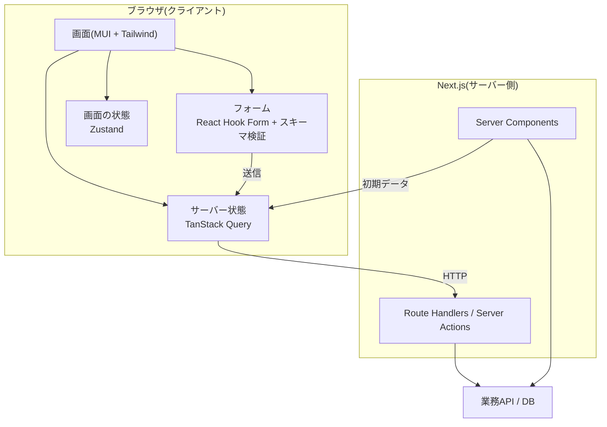
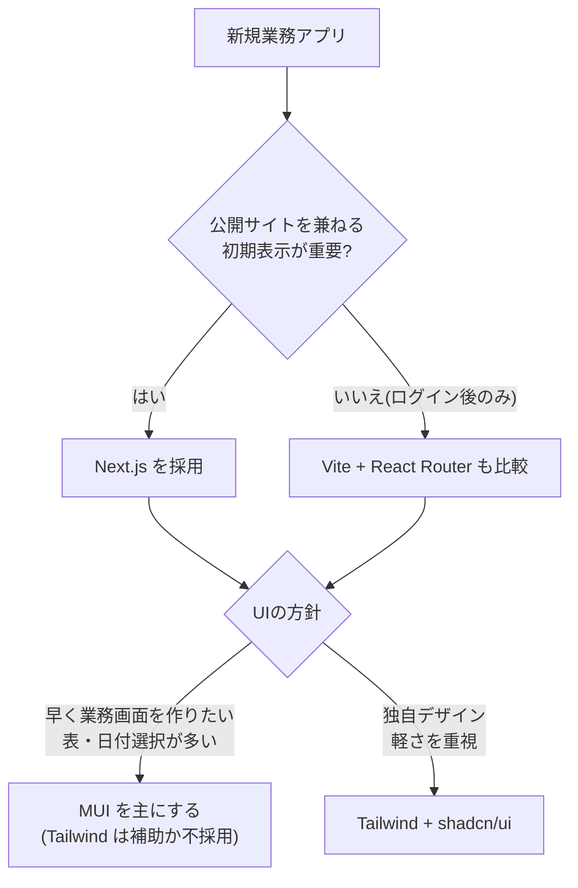

# 業務アプリ向けモダンフロントエンド構成レビュー(Next.js + TypeScript + MUI + Tailwind + RHF + TanStack Query + Zustand)

- **記録日:** 2026-10-14
- **位置づけ:** 「Next.js・TypeScript を土台に、MUI・テーマ・Tailwind CSS、React Hook Form、TanStack Query、Zustand を組み合わせて業務アプリを新規構築する」計画について、メリット・デメリットを星取表で整理し、競合・代替と比較したレビューです。
- **対象読者:** 初心者を含むチーム(専門用語は初出時に意味を補足します)。
- **根拠の種類:** ①GitHub・npm の実測データ(2026-10-14 取得)、②公式ドキュメントの記述、③筆者(AI)の評価、の3つを区別して書いています。③は検証済みの事実ではなく「見立て」です。
- **マスキング:** 固有情報・機密情報は含みません。

## 0. 結論

**総合評価: 採用可(条件付き)。** 個々の部品はどれも、人気・保守状況・ライセンス(MIT)の面で安心して選べる水準です。弱点は部品単体ではなく「組み合わせ」にあります。

| # | 要点 | 重要度 |
|---|---|---|
| 1 | **MUI と Tailwind は「どちらを主役にするか」を最初に決める。** 両方を使うと、スタイルの書き方が2系統になり、設計がぶれやすい | 🔴 高 |
| 2 | **サーバー状態は TanStack Query、画面の状態は Zustand と、責務を分ける。** 境界を決めないと、同じデータを二重に持つ | 🔴 高 |
| 3 | **Next.js の Server Components(サーバー側で描画する部品)と、MUI・TanStack Query・Zustand の相性を理解する。** 3つとも「クライアント側の部品」が前提で、設定が必要 | 🟠 中 |
| 4 | **社内向け(ログイン後)の業務アプリなら、Next.js は必須ではない。** Vite + React Router などの選択肢も比較する価値がある | 🟠 中 |
| 5 | **MUI は v9、Tailwind は v4、Next.js は v16 が前提。** 古い記事の手順は、そのままでは動かないことがある | 🟡 注意 |

## 1. 調査方法と限界

- **取得日:** 2026-10-14。GitHub API(Star・ライセンス・最終push)、npm API(週間ダウンロード・最新版)、各公式ドキュメント(Next.js、MUI、Tailwind CSS、TanStack Query、Zustand、React Hook Form)を直接取得しました。
- **awesome リスト:** `awesome-react`、`awesome-nextjs`、`awesome-react-components` の README を取得し、採用部品の掲載を確認しました(第9章)。
- **実装は未検証:** 実際にこの構成でアプリを作って測定したわけではありません。性能・開発体験の評価は、公式記述と一般的な知見に基づく筆者の見立てです。
- **数値の読み方:** npm の週間ダウンロードは、CI(自動ビルド)や依存パッケージ経由の分も含みます。「人気の目安」であり、利用者数そのものではありません。

## 2. 構成図



**役割分担の考え方(筆者案):**
- **TanStack Query:** サーバーから取ったデータの取得・キャッシュ・再取得・更新後の反映。
- **Zustand:** サーバーに無い、画面だけの状態(開閉、選択行、フィルタの下書きなど)。
- **React Hook Form:** 入力中のフォームの値・エラー。送信が終わったら TanStack Query の更新(mutation)へ渡す。

## 3. 採用構成の星取表(総合)

凡例: ◎=非常に良い、○=良い、△=注意が必要、×=不向き。評価は筆者の見立てです。

| 観点 | Next.js | TypeScript | MUI | Tailwind | React Hook Form | TanStack Query | Zustand |
|---|:-:|:-:|:-:|:-:|:-:|:-:|:-:|
| 枯れ具合(実績・安定) | ○ | ◎ | ◎ | ○ | ◎ | ◎ | ○ |
| 最近のトレンド | ◎ | ◎ | ○ | ◎ | ○ | ◎ | ◎ |
| 保守状況(2026-10 時点) | ◎ | ◎ | ◎ | ◎ | ◎ | ◎ | ◎ |
| 学習のしやすさ | △ | ○ | ○ | ○ | ○ | ○ | ◎ |
| 業務アプリ適性 | ○ | ◎ | ◎ | ○ | ◎ | ◎ | ○ |
| Next.js(サーバー描画)との相性 | - | ◎ | △ | ◎ | ○ | ○ | △ |
| 他部品との重複・衝突リスク | - | ◎ | △ | △ | ○ | ○ | ○ |
| 人材・情報の豊富さ | ◎ | ◎ | ◎ | ◎ | ◎ | ◎ | ○ |

**読み取り:**
- 弱点は「Next.js との相性」と「重複・衝突」の2行に集中しています。MUI(スタイル方式)、Tailwind(MUI との二重管理)、Zustand(サーバー描画での状態共有)です。
- 逆に、TypeScript、React Hook Form、TanStack Query は、ほぼ死角がありません。

## 4. 領域別の比較(実データつき)

### 4.1 フレームワーク(アプリ基盤)

| 候補 | Star | npm 週DL | 最新版 | 最終push | 枯れ | トレンド | 業務適性 | 総合 |
|---|--:|--:|---|---|:-:|:-:|:-:|:-:|
| **Next.js** | 143k | 67.5M | 16.4.0 | 2026-10 | ○ | ◎ | ○ | ◎ |
| React Router(v8) | 57k | 56.8M | 8.4.0 | 2026-10 | ◎ | ○ | ◎ | ○ |
| Vite(+ React) | 83k | 195.3M | 8.3.4 | 2026-10 | ○ | ◎ | ◎ | ○ |
| TanStack Start | - | 11.6M | - | - | △ | ◎ | ○ | △ |
| Angular(参考) | 101k | 6.2M | 22.2.2 | 2026-10 | ◎ | ○ | ◎ | ○ |
| Nuxt / Vue(参考) | 61k | 17.6M(vue) | 4.6.1 | 2026-10 | ○ | ○ | ○ | ○ |

**Next.js 16 の公式発表(要点):** Turbopack(高速なビルドツール)が標準、React Compiler(自動で再描画を抑える仕組み)が安定版、`middleware` が `proxy.ts` に置き換わり、Cache Components(明示的に選ぶキャッシュ方式)が登場しました。`params` の非同期化などの破壊的変更もあります。

**メリット**
- 実績・情報量・人材が最も豊富です。
- 画面ごとにサーバー描画とクライアント描画を選べ、初期表示の速さと SEO(検索結果での表示)に強みがあります。
- API の窓口(Route Handlers)を同じプロジェクトに置けます。

**デメリット**
- 概念が多く、学習コストが高めです(Server/Client Components、キャッシュ、描画方式)。
- 版が上がるたびに、キャッシュの仕組みや規約が変わってきた経緯があります。メジャー更新の追従コストを見込む必要があります。
- 認証後の社内業務アプリでは、SEO やサーバー描画の恩恵が小さく、複雑さだけが残る場合があります。

**判断の目安(筆者案):** 公開サイトを兼ねる、または初期表示速度が重要なら Next.js。ログイン後のみの社内システムなら、Vite + React Router も候補に入れて比較してください。

### 4.2 共通UIコンポーネント

| 候補 | Star | npm 週DL | 最新版 | 最終push | 枯れ | トレンド | 業務適性 | 総合 |
|---|--:|--:|---|---|:-:|:-:|:-:|:-:|
| **MUI (Material UI)** | 99k | 10.2M | 9.5.0 | 2026-10 | ◎ | ○ | ◎ | ◎ |
| shadcn/ui | 126k | -(部品をコピーする方式) | - | 2026-10 | △ | ◎ | ○ | ○ |
| Ant Design | 100k | 3.9M | 6.6.6 | 2026-10 | ◎ | ○ | ◎ | ○ |
| Mantine | 32k | 2.8M | 9.7.2 | 2026-10 | ○ | ○ | ◎ | ○ |
| Chakra UI | 41k | 1.6M | 3.37.0 | 2026-10 | ○ | △ | ○ | △ |
| Headless UI(参考) | 29k | 7.4M | 2.2.10 | 2026-04 | ○ | △ | △ | △ |

**メリット(MUI)**
- 部品が豊富で、業務アプリに必要なもの(表、日付選択、オートコンプリート、ダイアログ)が揃っています。
- 公式の Next.js 連携パッケージ(`@mui/material-nextjs`)と、Tailwind v4 との併用手順が公式ドキュメントにあります。
- テーマ(色・余白・フォントの一括設定)の仕組みが成熟しています。
- 高機能な表(MUI X Data Grid)があります。最新版 9.15.0。有償版の範囲は公式の料金ページで要確認です。

**デメリット(MUI)**
- 既定のスタイル方式(Emotion、実行時にスタイルを生成する CSS-in-JS)は、Server Components と相性が良くありません。公式の移行ガイドにも「Emotion はサーバー側コンポーネントを完全には支持していない」旨の記述があります。
- そのため `'use client'` の付与や、`AppRouterCacheProvider` の設置が必要です(公式の Next.js 連携手順)。
- 後継のビルド時スタイル方式 Pigment CSS は、公式の移行ガイドで「初期のアルファ段階」とされ、npm の最新版は 0.0.31、週DLは32kです。**本番の主軸にするのは時期尚早**と読めます。
- 見た目が Material Design 色になりやすく、独自デザインにはテーマの作り込みが要ります。
- v9 では対象ブラウザが引き上げられました(Chrome 117、Safari 17.0 以上)。

**補足(MUI のヘッドレス部品):** `@mui/base` は npm 上で非推奨(deprecated)で、後継は Base UI (`@base-ui/react`、週DL 17.4M、GitHub 11kStar・MIT)です。

### 4.3 スタイリングの重複(MUI + テーマ + Tailwind)

| 組み合わせ | 利点 | 欠点 | 評価 |
|---|---|---|:-:|
| **MUI だけ**(`sx` とテーマ) | 書き方が1系統。テーマで一元管理 | 細かい調整が `sx` に寄る。実行時スタイルの負荷 | ◎ |
| **Tailwind + shadcn/ui** | 部品を自前管理。軽い。今の主流 | 部品の保守が自前。高機能な表は別途必要 | ○ |
| **MUI + Tailwind(今回の案)** | MUI の部品 + Tailwind の素早い微調整 | 書き方が2系統。優先順位の衝突。ルールが必要 | △ |

**公式の併用手順(Tailwind v4):** MUI のスタイルを CSS の `@layer mui` に入れ(`enableCssLayer: true`)、レイヤー順を `@layer theme, base, mui, components, utilities;` と宣言すると、Tailwind のクラスが MUI のスタイルを確実に上書きできます。

**注意点(筆者の見立て):**
- 併用は可能ですが、「余白と色は Tailwind、部品の中身は MUI」のように**役割をコーディング規約で固定**しないと、レビューのたびに揺れます。
- テーマ(MUI)と Tailwind の色設定が別々にあるため、色の定義が二重になります。**色の元データは1か所に決め**、もう一方へ流し込む設計が必要です。
- Tailwind v4 の対象ブラウザは Chrome 111・Safari 16.4・Firefox 128 以上、MUI v9 は Chrome 117・Safari 17.0 以上です。**両方を使うと、実質は厳しい方(MUI 側)に揃います**(筆者の推論)。

### 4.4 フォーム

| 候補 | Star | npm 週DL | 最新版 | 最終push | 枯れ | トレンド | 業務適性 | 総合 |
|---|--:|--:|---|---|:-:|:-:|:-:|:-:|
| **React Hook Form** | 45k | 53.7M | 7.90.0 | 2026-10 | ◎ | ○ | ◎ | ◎ |
| Formik | 34k | 4.7M | 2.4.9 | 2025-11 | ◎ | × | ○ | △ |
| TanStack Form | 7k | 3.9M | 1.33.5 | 2026-10 | △ | ◎ | ○ | ○ |
| Conform | 3k | 317k | 1.21.2 | 2026-10 | △ | ○ | △ | △ |

**スキーマ検証(入力チェックの定義):** Zod(週DL 346.9M)、Valibot(22.5M、より軽量)、Yup(12.7M)。RHF とは `@hookform/resolvers`(週DL 43.9M)でつなぎます。TypeScript の型と検証を1つの定義から作れるため、**Zod の併用を推奨**します(筆者案)。

**メリット(RHF)**
- 入力のたびに画面全体を再描画しない設計で、項目数の多い業務フォームに強いです。
- 公式ドキュメントに MUI の `TextField` との連携例(`Controller`)があります。
- 実績・情報量が最大です。

**デメリット(RHF)**
- MUI のような「制御される部品」は `Controller` で包む必要があり、書く量が増えます。
- 動的な項目の配列(`useFieldArray`)は、慣れが要ります。
- Server Actions(サーバーに直接送る仕組み)との相性は、設計を工夫する必要があります(筆者の見立て)。

### 4.5 API通信・サーバー状態

| 候補 | Star | npm 週DL | 最新版 | 最終push | 枯れ | トレンド | 業務適性 | 総合 |
|---|--:|--:|---|---|:-:|:-:|:-:|:-:|
| **TanStack Query** | 50k | 65.1M | 5.104.2 | 2026-10 | ◎ | ◎ | ◎ | ◎ |
| SWR | 32k | 19.4M | 2.5.1 | 2026-09 | ○ | ○ | ○ | ○ |
| RTK Query(Redux Toolkit) | 11k | 33.5M | 2.13.0 | 2026-10 | ○ | ○ | ○ | ○ |
| Apollo Client(GraphQL) | 20k | 6.4M | 4.3.3 | 2026-10 | ○ | △ | ○(GraphQLなら) | △ |
| tRPC | 41k | 4.8M | 11.19.0 | 2026-10 | △ | ○ | ○(全部TSなら) | △ |

**メリット(TanStack Query)**
- キャッシュ、再取得、リトライ、楽観的更新(結果を先に画面へ反映する方式)、無限スクロールが標準で揃います。
- 業務アプリでありがちな「一覧 → 更新 → 一覧を最新化」が書きやすいです。
- 専用の ESLint プラグインと開発ツールがあります。

**デメリット**
- Next.js のサーバー描画と組み合わせるには、公式の「Advanced Server Rendering」手順が必要です。サーバーでは**リクエストごとに新しい QueryClient を作る**、`staleTime` を 0 より大きくする(すぐ再取得しないため)といった注意点が公式に明記されています。
- **データ取得を Server Components に任せるか、TanStack Query に任せるか**で設計が二分します。両方使うと責務が混ざりやすいです。
- 通信の部品(fetch、axios、ky)は別に選ぶ必要があります。axios は週DL 119.1M、ky は 7.2M です。

**API の型づくり(参考):** OpenAPI から型・クライアントを自動生成するツールに、`openapi-typescript`(9.5M)、`orval`(2.5M)、`@hey-api/openapi-ts`(5.4M)があります。API が OpenAPI で定義されているなら、手書きを減らせます。

### 4.6 クライアント状態管理

| 候補 | Star | npm 週DL | 最新版 | 最終push | 枯れ | トレンド | 業務適性 | 総合 |
|---|--:|--:|---|---|:-:|:-:|:-:|:-:|
| **Zustand** | 59k | 62.7M | 5.0.15 | 2026-10 | ○ | ◎ | ○ | ◎ |
| Redux Toolkit | 11k | 33.5M | 2.13.0 | 2026-10 | ◎ | △ | ◎ | ○ |
| Jotai | 21k | 6.7M | 3.0.1 | 2026-10 | ○ | ○ | ○ | ○ |
| Valtio | 10k | 2.2M | 2.3.2 | 2026-10 | ○ | △ | △ | △ |
| MobX | 28k | 3.9M | - | 2026-10 | ◎ | △ | ○ | △ |
| XState | 30k | 5.3M | - | 2026-10 | ○ | ○ | ◎(状態遷移が複雑なら) | ○ |
| Recoil | 19k | 452k | 0.7.7 | **アーカイブ済み** | - | × | × | × |

**メリット(Zustand)**
- 記述量が少なく、学習が最も容易です。ボイラープレート(定型コード)がほぼありません。
- 週DLは Redux Toolkit と同じ桁で、現在の主流です。

**デメリット**
- 公式の Next.js 手順に注意があります。**ストアはリクエストごとに作り、サーバーで共有してはいけません**。モジュール直下に1つ置く書き方は、サーバー側で他ユーザーの状態が混ざる事故の原因になります。公式は「グローバルなストアを避ける」ことを推奨しています。公式ページにも「このガイドは近く更新予定」との注記があります。
- 自由度が高い分、**書き方の規約を決めないと、チームごとにばらつきます**。
- 開発ツールやミドルウェアは、Redux ほど標準化されていません。

**Recoil について:** GitHub のリポジトリがアーカイブ済み(更新停止)です。新規では選びません。

## 5. 観点別レビュー

| 観点 | 評価 | 内容 |
|---|:-:|---|
| 保守性・長期運用 | ○ | 全部品が MIT ライセンスで、2026-10 時点で活発に更新されています。ただし部品数が7種と多く、**メジャー更新が年に数回重なる**ため、更新の運用(Renovate などの自動更新)が要ります |
| 採用・人材 | ◎ | どれも求人・情報が豊富です |
| 性能 | ○ | RHF、TanStack Query は軽量です。MUI の実行時スタイルは、表が大きい画面で負荷になり得ます(筆者の見立て) |
| アクセシビリティ(障害のある人にも使いやすいか) | ◎ | MUI v9 の公式移行ガイドが、キーボード操作・フォーカス管理の改善を明記しています |
| テスト | ○ | Vitest(週DL 125.3M)、Testing Library、Playwright(E2E)が標準的です。Server Components のテストは手法が確立途上です |
| セキュリティ | ○ | サーバー側に秘密情報を置けます(Next.js 公式)。ただし**クライアント部品にシークレットを渡さない**規約が必要です |
| 学習曲線 | △ | 初学者には、Server/Client の境界が最大の壁です |
| 移行・撤退のしやすさ | ○ | 部品ごとに分離しやすい構成です。UI層(MUI)だけは、後から変えるのが最も大変です |
| 国際化・認証など周辺 | ○ | `next-intl`、`react-i18next`、`better-auth`、`next-auth` などが定番です |

## 6. この組み合わせ固有の落とし穴

1. **Server / Client の境界:** MUI のテーマファイルには `'use client'` が必要で、Next.js の `Link` を MUI の部品へ渡すと「関数はクライアント部品へ渡せない」エラーが出ることが、公式ドキュメントに載っています。ラッパー部品の作成が前提です。
2. **Next.js 公式の CSS-in-JS 一覧:** MUI はクライアント部品で対応済みと記載される一方、Emotion は「対応を進めている」状態です。つまり**MUI の部品は、基本的にクライアント側で動く**前提で設計します。
3. **QueryClient をモジュール直下に置かない:** リクエストをまたいでデータが混ざります(公式が警告)。
4. **ストアの共有:** Zustand も同様です。
5. **バージョン固定:** MUI 周辺(`@mui/material`、`@mui/material-nextjs`、`@mui/icons-material` など)は、メジャー版を揃える必要があります(v9 移行ガイドに明記)。
6. **ESLint・型の運用:** 7部品分の設定が増えるため、プロジェクトのひな形(テンプレート)を最初に1つ作り、全員が同じ形から始めます。

## 7. 推奨と代替案



| 案 | 構成 | 向いている場合 | 評価 |
|---|---|---|:-:|
| **A(今回の計画)** | Next.js + MUI + Tailwind + RHF + TanStack Query + Zustand | 部品の豊富さと素早い調整を両取りしたい | ○(規約が前提) |
| **B(MUI 主役)** | A から Tailwind を外す | 書き方を1系統にして、迷いを減らしたい | ◎ |
| **C(Tailwind 主役)** | Next.js + Tailwind + shadcn/ui + RHF + TanStack Query + Zustand | 独自デザインで軽く作り、部品は自前で管理できる | ○ |
| **D(社内SPA)** | Vite + React Router + MUI + RHF + TanStack Query + Zustand | ログイン後のみ。サーバー描画が不要 | ○ |

**筆者の推奨:** まず**案B(Tailwind を入れない)**を基準にし、Tailwind が本当に必要な場面が出てから追加するのが、最も安全です。理由は、後から足すのは簡単ですが、二重の書き方に慣れた後で外すのは大変だからです。最終判断は、チームの経験と、デザインの要件で決めてください。

## 8. 実測データ

### 8.1 npm 週間ダウンロード(2026-10-14 取得、長いほど多い)

```
Next.js               ███████              67.5M
React Router          ██████               56.8M
Vite                  ████████████████████ 195.3M
Angular core          █                    6.2M
Vue                   ██                   17.6M
```

```
Tailwind CSS          ████████████████████ 137.3M
Radix(dialog)         ███████████          73.5M
MUI                   █                    10.2M
Headless UI           █                    7.4M
Ant Design            █                    3.9M
Mantine               █                    2.8M
Chakra UI             █                    1.6M
daisyUI               █                    1.1M
```

```
React Hook Form       ████████████████████ 53.7M
Formik                ██                   4.7M
TanStack Form         █                    3.9M
Conform               █                    317k
```

```
TanStack Query        ████████████████████ 65.1M
Redux Toolkit         ██████████           33.5M
SWR                   ██████               19.4M
Apollo Client         ██                   6.4M
tRPC client           █                    4.8M
```

```
Zustand               ████████████████████ 62.7M
Redux                 ███████████████      46.8M
Jotai                 ██                   6.7M
XState                ██                   5.3M
MobX                  █                    3.9M
Valtio                █                    2.2M
Recoil                █                    452k
```

### 8.2 GitHub(Star・ライセンス・最終push)

| リポジトリ | Star | ライセンス | 最終push |
|---|--:|---|---|
| vercel/next.js | 143k | MIT | 2026-10-14 |
| facebook/react | 251k | MIT | 2026-10-14 |
| microsoft/TypeScript | 111k | Apache-2.0 | 2026-10-14 |
| mui/material-ui | 99k | MIT | 2026-10-14 |
| mui/pigment-css | 1k | MIT | 2026-10-08 |
| shadcn-ui/ui | 126k | MIT | 2026-10-14 |
| ant-design/ant-design | 100k | MIT | 2026-10-14 |
| mantinedev/mantine | 32k | MIT | 2026-10-11 |
| chakra-ui/chakra-ui | 41k | MIT | 2026-10-12 |
| tailwindlabs/tailwindcss | 98k | MIT | 2026-10-13 |
| react-hook-form/react-hook-form | 45k | MIT | 2026-10-14 |
| jaredpalmer/formik | 34k | Apache-2.0 | 2025-11-10 |
| TanStack/query | 50k | MIT | 2026-10-14 |
| vercel/swr | 32k | MIT | 2026-09-22 |
| pmndrs/zustand | 59k | MIT | 2026-10-14 |
| pmndrs/jotai | 21k | MIT | 2026-10-07 |
| reduxjs/redux-toolkit | 11k | MIT | 2026-10-06 |

## 9. awesome シリーズでの掲載確認

| リスト | Star | 確認できたこと |
|---|--:|---|
| awesome-react | 74k | `react-hook-form`、`tanstack-query`、`shadcn-ui` を掲載。Zustand、Jotai、Redux、SWR、Mantine、Chakra UI も言及あり |
| awesome-nextjs | 11k | Tailwind 関連の言及が最多(23回)。Redux 14回、Material 6回、shadcn 5回。**Next.js と Tailwind の組み合わせが主流であること**がうかがえます |
| awesome-react-components | 48k | Material UI 関連が46回で最多。Redux 57回、Mantine 12回、Tailwind 12回。**古くからの UI 部品の定番が MUI** であることがうかがえます |

**読み取り(筆者の見立て):** awesome 系は「掲載数」であって、品質や推奨度ではありません。ただし、MUI は老舗の定番、Tailwind と shadcn/ui は Next.js 文脈の新しい主流、という傾向は一致します。`awesome-react` はライセンス表記が無く、最終更新は 2026-09 です。

## 10. 確認できていないこと(限界)

- 実際に構築しての性能測定、バンドルサイズ比較、開発体験の評価は**していません**。
- MUI X(高機能な表など)の有償・無償の範囲は、公式の料金ページで要確認です。
- 評価記号(◎○△×)は筆者の見立てで、数値化した基準はありません。
- Pigment CSS の公式ドキュメントが「Turbopack 非対応」と書く点は、Next.js 16 で Turbopack が標準になった現在と食い違う可能性があります。最新状況は公式で要確認です。
- Zustand の Next.js 手順は、公式が「更新予定」としています。
- TypeScript は npm 上の最新版が 7.x です。メジャー更新の影響(ビルド・ツール連携)は、今回は調べていません。

## 参考リンク(公式)

- Next.js 16: https://nextjs.org/blog/next-16
- Next.js Server/Client Components: https://nextjs.org/docs/app/getting-started/server-and-client-components
- Next.js CSS-in-JS: https://nextjs.org/docs/app/guides/css-in-js
- MUI × Next.js: https://mui.com/material-ui/integrations/nextjs/
- MUI × Tailwind CSS v4: https://mui.com/material-ui/integrations/tailwindcss/tailwindcss-v4/
- MUI v9 移行: https://mui.com/material-ui/migration/upgrade-to-v9/
- Pigment CSS 移行: https://mui.com/material-ui/migration/migrating-to-pigment-css/
- Tailwind CSS 互換性: https://tailwindcss.com/docs/compatibility
- React Hook Form: https://react-hook-form.com/get-started
- TanStack Query SSR: https://tanstack.com/query/latest/docs/framework/react/guides/advanced-ssr
- Zustand × Next.js: https://zustand.docs.pmnd.rs/learn/guides/nextjs
- awesome-react: https://github.com/enaqx/awesome-react
- awesome-nextjs: https://github.com/unicodeveloper/awesome-nextjs
- awesome-react-components: https://github.com/brillout/awesome-react-components

## Author and Ownership / 著作権と所属について

This project was created as a personal initiative and is not connected to any organization or group.
It is published as an individual creative work.

本プロジェクトは個人の活動として作成したものであり、特定の組織や団体の業務とは関係ありません。
個人の創作物として公開しています。
