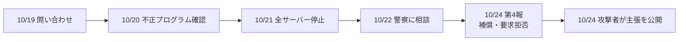
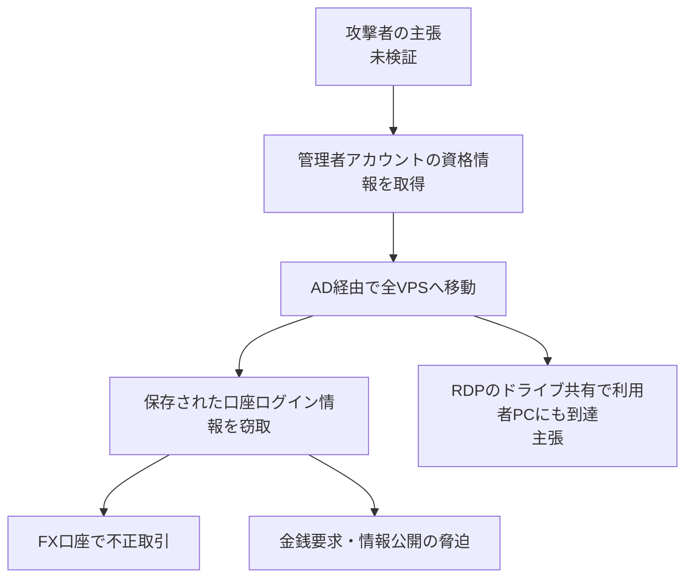

# GMO「お名前.com デスクトップクラウド」不正アクセス事案の調査(FX口座の不正取引・身代金要求・AD関与の真偽)

- **記録日:** 2026-10-26
- **位置づけ:** 2026年10月19日〜24日に起きた、GMOインターネットの仮想デスクトップ(VPS)サービス「お名前.com デスクトップクラウド」への不正アクセスと、FX口座の不正取引被害を、公式発表と報道・解説から整理した調査メモです。
- **対象読者:** 初心者を含む方(専門用語は初出時に意味を補足します)。
- **根拠の区別:** 本文は次の3種類を明示して書き分けます。
  - 【公式】GMOの発表(第1報〜第4報)で確認できる事実
  - 【攻撃者主張】攻撃者を名乗る人物の主張(未検証)
  - 【見立て】筆者(AI)の整理・推測
- **取得範囲の注意:** 公式の第2〜4報は本文を直接読みました。攻撃者の主張は、攻撃者サイトを直接見ず、解説記事(note「脱線ノート」)経由です。新聞各社(毎日・読売・産経・ロイター)は検索結果の見出しのみ確認し、本文は未取得です。
- **マスキング:** 個人・機密情報は含みません。攻撃者サイトのアドレスは意図的に記載しません。

> 用語: 依頼文の「VHS」は、GMOの仮想サーバー(VPS: Virtual Private Server、インターネット上の自分専用の仮想パソコン)と解釈しました。

## 0. 結論(3つの質問への回答)

1. **AD(Active Directory)は関係するか?**
   - 【公式】侵入経路・原因の詳細は未公表です。ADが関与したかは、GMOは確認も否定もしていません。
   - 【攻撃者主張】「VPS網がADで構成され、全サーバーに入れる管理者アカウントがあり、それで全体を掌握できた」と主張しています。未検証です。
   - 【見立て】主張は技術的にあり得る筋書きですが、証拠(構成図・ログ)は示されておらず、断定できません。
2. **身代金の要求にGMOは応じなかったか?**
   - 【公式】応じていません。第4報で「攻撃者からの要求には応じない」と明言しました。理由は「応じても、情報の削除や不正利用の防止は保証されないため」です。
   - 要求を受けた事実も認めています。ただし要求額は、公式発表に記載がありません(報道では100万ドルとの情報がありますが、本文未確認です)。
3. **FX口座の被害は?**
   - 【公式】一部の利用者から、身に覚えのない取引の報告があり、損失は補償する方針です。被害総額は公表されていません。

## 1. 何が起きたか(概要)

- **サービス:** 「お名前.com デスクトップクラウド」は、インターネット越しにWindowsの仮想パソコンを借りるサービスです。FXの自動売買ソフト(MT4/MT5)を24時間動かす用途で多く使われます。
- **被害:** 利用者のサーバー内に保存されていた、取引ツールや口座のログイン情報が第三者に見られ、不正に使われました。
- **規模:** 影響の可能性があるサーバーは**26,739件**(全プラン)です。これは対象になり得る数で、侵入が確認された数ではありません。
- **決済情報:** クレジットカード情報は、サーバー上に保持していないとされています。

## 2. 時系列【公式】

- 10/19: 利用者からの問い合わせで調査開始
- 10/20: 不正なプログラムの設置を確認。新規申込とコントロールパネルを停止
- 10/21 4:00: 全プランのサーバーを順次停止。第1報
- 10/21以降: 口座の不正操作の報告を受付。取引会社へ共有
- 10/22: 警察に相談。16:59 第2報(パスワード変更・セッション切断を依頼)
- 10/23 16:10: 第3報(影響範囲の整理、二次被害の注意)
- 10/24 11:50: 第4報(見舞金・補償・金銭要求への方針・能動的サイバー防御の要請)
- 10/24: 攻撃者を名乗る人物が、侵入経路などを自身のサイトで公開【攻撃者主張】

## 3. 公式が認めた事実(第4報)

- サービスのシステムにセキュリティ上の問題が存在した。
- 不正アクセスがあり、**顧客情報が外部へ持ち出された**。
- 一部の利用者の口座で、身に覚えのない取引があった。
- 攻撃者とみられる者から金銭を要求された。

## 4. 身代金(金銭要求)について【公式】

- **要求の内容(脅迫):**
  - 国内外70超の証券会社・FX会社の口座への不正操作の継続
  - サービスと、接続した利用者PCに関する情報の公開、およびランサムウェア(データを人質にする攻撃)の実行
  - GMOのシステムや運用体制に関する情報の公開
- **GMOの対応方針:**
  - 要求には応じない(応じても削除や悪用防止の保証がないため)。
  - 通信記録などの証拠を警察のサイバー犯罪部門へ提出し、刑事事件として捜査を要請。
  - 主要な取引会社に、このサービス経由のアクセス遮断、全セッションの強制切断、不正取引の監視を要請。
- **注意喚起:** 攻撃者が今後公開する情報には、事実と異なる内容が含まれる恐れがある、と警告しています。
- **特徴:** データを暗号化せず、盗んだ情報で恐喝する「二重脅迫」型と報じられています。

## 5. ADは関係するか(攻撃者の主張と評価)

### 攻撃者の主張【攻撃者主張・未検証】
- VPS網はActive Directory(AD、Windows環境の利用者・端末・権限を一元管理する仕組み)で構成されていた。
- **全VPSに管理者権限で入れるアカウント**があり、サポート担当が利用者PCに接続した際に、その認証情報を取得できた。
- 利用者に配布されたリモートデスクトップ(RDP)の接続ファイルで、**ドライブ共有が既定で有効**だった。そのため、VPSだけでなく利用者自身のPCからもデータを取れた。
- この構成は少なくとも2019年から存在した。解約済みの数千台が停止されず稼働していた。
- 取得データ: MT4/MT5口座情報 約14万口座(リアル9万超、デモ5万超)、閲覧履歴、認証情報、個人データなど。

### 評価【見立て】
- GMOは、ADや共通管理者アカウントが実際の侵入経路だったかを**公表していません**。
- ADを使うこと自体は問題ではありません。問題は、顧客ごとの環境と管理権限が分離されていたかです。
- RDPのドライブ共有は、2026年4月のWindows更新で既定の挙動が厳しくなっています(解説記事より)。ただし接続方法や更新状況で動作が異なり、この点だけで主張の真偽は決まりません。
- 約14万口座という数字や「全利用者PCに到達可能」は、公式の確認がありません。**鵜呑みにせず、GMOの原因調査の公表を待つ**のが妥当です。
- 一般論として、ADの管理者資格情報の窃取は、企業侵害で典型的な拡大手口です(例: ADを人質にして恐喝する攻撃が2026年10月にITmediaで報じられています)。今回と同じ手口と断定する根拠はありません。

## 6. FX口座の被害と補償【公式】

- **見舞金:** 現在の全利用者に、被害の有無にかかわらず一律5,000円。案内は10/30までにメールで。
- **損失補償:** 本件に起因すると当社が認めた不正取引の**実現損失**(差損と手数料)が対象です。
  - 対象外: 市場変動による損失、得られたはずの利益などの間接損害。
  - 取引会社から返金があれば差し引き、返金されない場合も当社が支払います。
  - 申請方法や期間は11/6までに案内の予定です。
- **代替サービス:** 現行基盤は再開せず、独立したクラウド基盤の代替サービスを案内(6か月無償、同意なく移行はしない)。
- **被害額:** 報道に個人の被害額(600万円超との訴え)がありますが、GMOは総額を公表していません。

## 7. 政府への要請【公式】

- 第4報で、**能動的サイバー防御**(国が主導して攻撃者の基盤を特定・無力化する枠組み)の「発動第1号」として、政府機関へ緊急要請したと発表しました。
- 報道(SBbit)には「現行法制度では課題がある」との論評があります(見出しのみ確認)。

## 8. 利用者が取るべき対策【公式を要約】

- 取引口座とツールのパスワードを、**サービスと無関係の端末**から変更する。
- パスワード変更後も既存セッションが残る場合があるため、**全セッションを切断**(取引会社へ依頼)。
- 取引履歴と残高を確認し、不審な取引は取引会社へ連絡。二段階認証を有効にする。
- サーバー内やブラウザに保存した他サービスのID・パスワードも変更する。
- 自分のPCのフルスキャンとバックアップ(取り扱いに注意)。
- 便乗フィッシングや、犯人を名乗る連絡には返信・URL開封をしない。

## 9. 別件との区別

- 同時期に、GMOグループの別の事案が報じられています。**本件との関連は確認できていません**。
  - ConoHa WINGの一部顧客のサーバーへの不正アクセス(9月20日に発表、426アカウントに影響と報道)
  - GMOリサーチ&AIの個人情報漏えい(最大約95万人分、10月6日に報道)
- いずれも検索結果の見出しや抜粋のみの確認です。

## 10. 筆者の見立てと限界

- 【見立て】公式が「システムに問題が存在した」「不備を認める」と書いたことは、相当に重い自認です。基盤を再開せず作り直す判断も、構造的な問題を示唆します。
- 【見立て】クラウド事業者の侵害は、利用者側の対策だけでは防げません。サーバーに口座のパスワードを保存する運用のリスクが、改めて示されました。
- **限界:** 侵入経路、被害額、攻撃者の身元は未確定です。第5報以降で内容が変わる可能性があります。ADに関する記述は、公式確認が出るまで「主張」として扱ってください。

## 11. 出典

- GMOインターネットグループ: 第2報(2026-10-22) https://group.gmo/info/alert/20261022/
- GMOインターネット: 第3報(2026-10-23) https://internet.gmo/news/article/248/
- GMOインターネット: 第4報(2026-10-24) https://internet.gmo/news/article/249/
- 第1報 https://www.onamae.com/news/article/11584
- 脱線ノート「攻撃者が侵入経路を公開。ADとRDPに何があったのか」(2026-10-24) https://note.com/offtrack_notes/n/n2511c6ce0fcd (攻撃者の主張の出典)
- 報道(見出しのみ確認): 毎日新聞、読売新聞、産経新聞、ロイター、NHK、FNN、SBbit(いずれも2026-10-23〜24)
- Microsoft Japan Windows Technology Support Blog: 2026年4月のRDPファイルの警告変更 https://jpwinsup.github.io/blog/2026/04/24/RemoteDesktopService/RDS/RDPSecurityWarnings/
