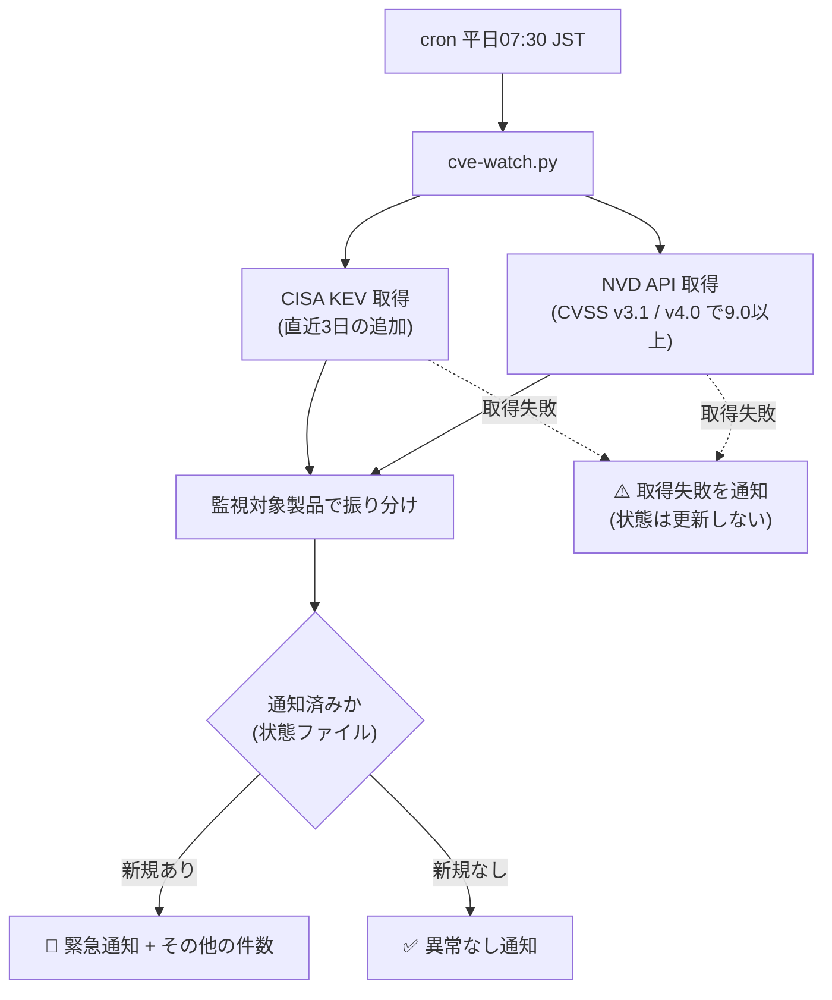

# 緊急脆弱性ウォッチ(平日07:30)構築手順

- **記録日:** 2026-11-05
- **目的:** 直近3日の「CVSS 9.0以上」または「悪用が確認された(CISA KEV)」脆弱性を、監視対象製品を優先して毎平日自動で通知する(2026-11-19から、CVE公開前の予告・注意喚起も別枠で通知)。
- **方針:** AI(LLM)を使わない `no_agent` 型。コスト・トークン消費ゼロ。標準ライブラリのみ(追加導入なし)。

## 全体の流れ

## 構成要素

| 項目 | 内容 |
|---|---|
| スクリプト | `~/.hermes/scripts/cve-watch.py` |
| 状態ファイル | `~/.hermes/state/cve-watch.json`(通知済みCVEを30日保持) |
| cron | ジョブ名 `weekday-cve-watch` / `30 7 * * 1-5`(JST) / `no_agent=true` / 配信先は元のDiscord |
| データ源 | CISA KEV(JSON)、NVD API 2.0(鍵なし・無料枠) |

## 監視対象製品(優先通知)
- **Linux系:** Apache HTTP Server / Tomcat、WordPress(本体・プラグイン)、MySQL/MariaDB、PHP、Linuxカーネル、OpenSSL
- **Windows系:** IIS、SQL Server、.NET/ASP.NET、Windows(HTTP.sys等)、Exchange Server
- **開発基盤・クラウド(2026-11-05追加):** Python(CPython)、Django、TypeScript、Next.js、Go言語、Rust、Git、GitHub(Enterprise Server/Actions等)、AWS
  - 一般語(go、git、aws等)による誤検知を避けるため、CPE(製品識別子)・製品名・バージョン表記に寄せた条件にしている。
- 緊急の条件: 監視対象で「CVSS 9.0以上」または「KEV掲載」。対象外は「その他 N件」として1行のみ。

## 時刻の選定理由
既存ジョブは毎時00分(監視・中継)、07/11/17時00分(taskboard-poller)、週次・月次は深夜1:30〜5:00に集中。07:30もこれらと重ならない(07:00のtaskboard-pollerとは30分離れている)。
2026-11-26に、インシデントウォッチ(旧07:30)と時刻を入れ替え、**脆弱性は朝07:30、インシデントは昼11:30**とした。

## 検証結果(2026-11-05)
1. 構文チェック: 合格
2. 正常系(`--dry`、状態を更新しない): WordPress関連3件を検出、約10秒
3. 異常系(通信失敗を模擬): 「異常なし」と誤表示する不具合を発見 → 「⚠️取得できず、異常なしと判定できません」へ修正し再試験で合格。失敗時は状態を更新せず取りこぼしを防止
4. 重複除外: 1回目に保存→2回目は新規ゼロで「異常なし」。試験用の状態ファイルは削除済み(初回の本番実行は、直近3日分が新規として通知される)

## 通知の見方(カード形式)
緊急案件ごとに、次の5項目を日本語で表示する(AI不使用。公式データからの決め打ち変換)。

| 項目 | 元データ | 内容 |
|---|---|---|
| 📦 製品 | NVDのCPE(製品識別子)・説明文 | 製品名と、対象バージョン(新しい系列を優先して表示) |
| 🎯 攻撃条件 | CVSSベクタ(AV/PR/UI/AC) | 遠隔かローカルか、認証の要否、利用者の操作の要否、成立の難しさ |
| 🖱 操作 | 同上 | 攻撃者が何をするか(例: 細工したリクエストを送るだけ) |
| 💥 可能な攻撃 | CWE(弱点の種類)・説明文のキーワード | 乗っ取り、情報漏えい、サービス停止など(重複は除去) |
| 🛠 対処 | 修正版の有無・CISA KEV | 修正版あり→最新パッチ適用(更新先の版を表示)。修正版が未確認→外部公開の停止・接続元の制限。悪用中かつ遠隔・認証不要は、適用までの外部公開制限を併記 |

- KEVのみでNVDの詳細がまだ無い案件は、NVDへ個別に問い合わせて補う(最大4件)。
- 1通の文字数(Discord上限)に収まらない分は「詳細は省略」としてCVE番号のみ列挙する。
- 試験用に、状態ファイルの場所を環境変数 `CVEWATCH_STATE` で切り替えられる。

## 予告・注意喚起の枠(2026-11-19追加)
- **背景:** NVD(脆弱性データベース)とCISA KEV(悪用確認リスト)は、**CVE公開後**でないと載らない。PHPの月次セキュリティリリースのように、公開前に「事前準備のお願い」が出る案件は、従来の方式では拾えなかった。
- **追加した情報源:** IPA(`alert-rss.rdf`)、JPCERT/CC(`jpcert.rdf`)、php.net(`feed.atom`)。直近5日分を見る。
- **絞り込み:** タイトルに「事前準備・予告・セキュリティリリース・注意喚起・脆弱性対策・緊急・security release」等を含み、かつ監視対象製品(PHP、nginx、Apache、WordPress、OpenSSL、MySQL/MariaDB、Linuxカーネル、Microsoft等)に関するものだけ通知する。RC版(試験版)は除外。php.netは「released」も対象(修正版の公開を拾うため)。
- **表示:** 通知の先頭付近に「📢 予告・注意喚起」枠を表示。通知済みは状態ファイルに記録し重複通知しない。
- **PHPの検知語を拡張:** NVDの説明文が「PHP has…」「PHP before…」等で始まる案件も、監視対象として拾う。
- **異常時:** 新枠の情報源が取得できなくても、既存の判定は止めず「⚠️ ○○取得失敗」と表示する。
- **検証:** 正常系でIPAの「PHPのセキュリティリリース公開予定(11月)」とnginx脆弱性の注意喚起を検知。異常系(php.net不達を模擬)で警告表示を確認。本番の状態ファイルは試験で変更していない。
- **退避:** 改修前のスクリプトを退避済み(戻す場合はそのファイルを`~/.hermes/scripts/cve-watch.py`へコピーし直す)。

## 既知の制約
- NVDへの掲載は公表から数時間〜1日遅れる。3日窓と重複除外で補う。
- NVDが未採点の直後は「CVSS未評価」と表示される(KEV掲載なら緊急として通知される)。
- 監視対象の判定は製品名の文字列一致。見落とし・過検知があり得る(NVDのCPE情報が空のプラグイン等)。
- 製品名の追加・変更は、スクリプト冒頭の `WATCH` 一覧を編集する。

## 運用コマンド(参考)
- 次回実行時刻の確認: Hermesのcron一覧(`cronjob` の list)で `next_run_at` を見る。
- 手動試験(通知なし・状態更新なし): `python3 ~/.hermes/scripts/cve-watch.py --dry`
- 一時停止・再開・削除: Hermesのcron管理(`cronjob` の pause / resume / remove)

## 変更履歴
- 2026-11-05: 通知を「製品・攻撃条件・操作・可能な攻撃・対処」のカード形式に変更。
- 2026-11-05: 監視対象に開発基盤・クラウド9製品を追加(`WATCH`一覧への追記のみ)。文例テスト(肯定12件・否定6件)と、窓を14日に広げた試験で確認。

- 2026-11-19: 「予告・注意喚起」の枠(IPA・JPCERT/CC・php.net)を追加。PHPの検知語を拡張。
- 2026-11-26: 実行時刻を平日11:30から**平日07:30**へ変更(インシデントウォッチと入れ替え)。cronの `schedule` のみ変更し、スクリプトは不変。

## 参考(公式)
- CISA KEV カタログ: https://www.cisa.gov/known-exploited-vulnerabilities-catalog
- NVD API 2.0: https://nvd.nist.gov/developers/vulnerabilities
- CVSS v3.1 仕様: https://www.first.org/cvss/v3.1/specification-document

## Author and Ownership / 著作権と所属について

This project was created as a personal initiative and is not connected to any organization or group.
It is published as an individual creative work.

本プロジェクトは個人の活動として作成したものであり、特定の組織や団体の業務とは関係ありません。
個人の創作物として公開しています。
