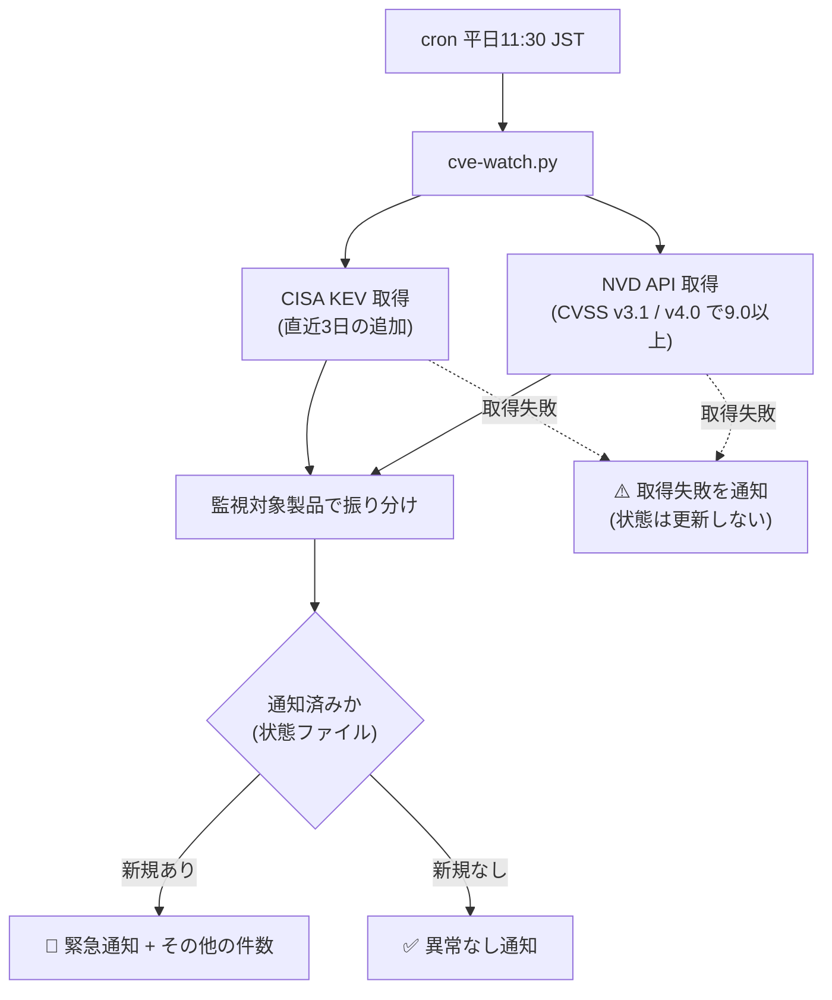

# 緊急脆弱性ウォッチ(平日11:30)構築手順

- **記録日:** 2026-11-05
- **目的:** 直近3日の「CVSS 9.0以上」または「悪用が確認された(CISA KEV)」脆弱性を、監視対象製品を優先して毎平日自動で通知する。
- **方針:** AI(LLM)を使わない `no_agent` 型。コスト・トークン消費ゼロ。標準ライブラリのみ(追加導入なし)。

## 全体の流れ

## 構成要素

| 項目 | 内容 |
|---|---|
| スクリプト | `~/.hermes/scripts/cve-watch.py` |
| 状態ファイル | `~/.hermes/state/cve-watch.json`(通知済みCVEを30日保持) |
| cron | ジョブ名 `weekday-cve-watch` / `30 11 * * 1-5`(JST) / `no_agent=true` / 配信先は元のDiscord |
| データ源 | CISA KEV(JSON)、NVD API 2.0(鍵なし・無料枠) |

## 監視対象製品(優先通知)
- **Linux系:** Apache HTTP Server / Tomcat、WordPress(本体・プラグイン)、MySQL/MariaDB、PHP、Linuxカーネル、OpenSSL
- **Windows系:** IIS、SQL Server、.NET/ASP.NET、Windows(HTTP.sys等)、Exchange Server
- 緊急の条件: 監視対象で「CVSS 9.0以上」または「KEV掲載」。対象外は「その他 N件」として1行のみ。

## 時刻の選定理由
既存ジョブは毎時00分(監視・中継)、07/11/17時00分(taskboard-poller)、週次・月次は深夜1:30〜5:00に集中。11:30はこれらと重ならない。

## 検証結果(2026-11-05)
1. 構文チェック: 合格
2. 正常系(`--dry`、状態を更新しない): WordPress関連3件を検出、約10秒
3. 異常系(通信失敗を模擬): 「異常なし」と誤表示する不具合を発見 → 「⚠️取得できず、異常なしと判定できません」へ修正し再試験で合格。失敗時は状態を更新せず取りこぼしを防止
4. 重複除外: 1回目に保存→2回目は新規ゼロで「異常なし」。試験用の状態ファイルは削除済み(初回の本番実行は、直近3日分が新規として通知される)

## 既知の制約
- NVDへの掲載は公表から数時間〜1日遅れる。3日窓と重複除外で補う。
- NVDが未採点の直後は「CVSS未評価」と表示される(KEV掲載なら緊急として通知される)。
- 監視対象の判定は製品名の文字列一致。見落とし・過検知があり得る(NVDのCPE情報が空のプラグイン等)。
- 製品名の追加・変更は、スクリプト冒頭の `WATCH` 一覧を編集する。

## 運用コマンド(参考)
- 手動試験(通知なし・状態更新なし): `python3 ~/.hermes/scripts/cve-watch.py --dry`
- 一時停止・再開・削除: Hermesのcron管理(`cronjob` の pause / resume / remove)

## 参考(公式)
- CISA KEV カタログ: https://www.cisa.gov/known-exploited-vulnerabilities-catalog
- NVD API 2.0: https://nvd.nist.gov/developers/vulnerabilities
- CVSS v3.1 仕様: https://www.first.org/cvss/v3.1/specification-document

## Author and Ownership / 著作権と所属について

This project was created as a personal initiative and is not connected to any organization or group.
It is published as an individual creative work.

本プロジェクトは個人の活動として作成したものであり、特定の組織や団体の業務とは関係ありません。
個人の創作物として公開しています。
