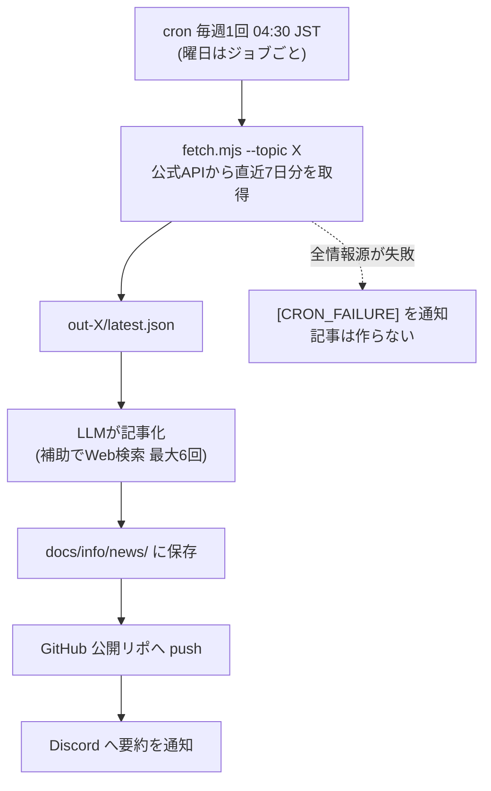

# AI・AIエージェント週次ウォッチ(4ジョブ)構築手順

- **記録日:** 2026-11-26
- **目的:** 既存の週次まとめがマンネリ化したため、「AIおよびAIエージェント」を括りに、テーマ別の週次ウォッチを4本追加する。既存の週次ジョブ(`weekly-claude-automation-knowledge`)は変更せず残す(追加のみ)。
- **方針:** 事実の取得は、公式APIのみを使うスクリプト(LLM不使用)。LLMは記事化・解説だけを担当。1ジョブあたりの検索量を減らし、Web検索の制約にもかかりにくくする。

## 全体の流れ

## ジョブ一覧(JST、毎週)

| 曜日 | ジョブ名 | テーマ | 記事ファイル名 |
|---|---|---|---|
| 火 04:30 | `weekly-ai-claude-skills` | Claude Skills(Agent Skills) | `YYYYMMDD_INFO_CLAUDESKILLS_claude-skills-weekly.md` |
| 水 04:30 | `weekly-ai-mcp` | MCP(Model Context Protocol) | `YYYYMMDD_INFO_MCP_mcp-weekly.md` |
| 金 04:30 | `weekly-ai-security` | AI・AIエージェント特化の脆弱性とセキュリティインシデント | `YYYYMMDD_INFO_AISECURITY_ai-security-weekly.md` |
| 土 04:30 | `weekly-ai-agent-context` | システムプロンプト・設定ファイル(CLAUDE.md、AGENTS.md、MEMORY.md等) | `YYYYMMDD_INFO_AICONTEXT_agent-context-files-weekly.md` |

- **時刻の選定理由:** 既存の週次ジョブは深夜1:30〜3:30に集中している。04:30は、それらと同じ時刻に重ならず、直前のジョブと最低1時間の間隔が空く。毎時00分の監視・07/11/17時のタスクボードの処理とも重ならない。
- **曜日の割り当て:** 最初の案では金=設定ファイル、土=セキュリティだったが、依頼により金=セキュリティ、土=設定ファイルに入れ替えた。
- **配信:** Discord通知 + GitHub公開リポ(`docs/info/news/`)。既存のクラウド人気記事ジョブと同じ置き場。
- **モデル設定:** 既存の週次ジョブと同じ(固定)。ツールセットは Web・端末・ファイル・GitHub に限定(トークン消費の抑制)。

## 構成要素

| 項目 | 内容 |
|---|---|
| データ取得スクリプト | `~/optimus/tasks/ai-watch/fetch.mjs`(Node標準のfetchのみ、依存ゼロ) |
| 出力 | `~/optimus/tasks/ai-watch/out-<topic>/latest.json` と `YYYY-MM-DD.json` |
| 実行方法 | `node fetch.mjs --topic skills\|mcp\|context\|security [--days 7]` |
| 認証 | GitHub APIは環境変数 `GITHUB_TOKEN` があれば使う(無くても動く。値は出力しない) |
| 失敗時の扱い | 情報源単位の失敗は `errors[]` に記録して続行。全滅のときだけ `allFailed=true`(終了コード1) |

## 情報源の採否(すべて公式API・公式フィード)

| テーマ | 採用した情報源 |
|---|---|
| Skills | `anthropics/skills` と `agentskills/agentskills`(規格)のコミット・リリース。GitHub検索(トピック `agent-skills`、新着の人気リポ)。 |
| MCP | `modelcontextprotocol` の仕様・サーバ集・レジストリのコミット/リリース、TypeScript・Python SDKのリリース。GitHub検索(トピック `mcp-server`、新着と急上昇)。 |
| 設定ファイル | `anthropics/claude-code` と `openai/codex` のリリース(設定ファイル・メモリ・フック等に関する行だけ抜粋)、`agentsmd/agents.md` のコミット。 |
| セキュリティ | NVD(AI関連16キーワード、1件ずつ6.5秒待つ)、GitHub Security Advisories(AI関連パッケージ)、CISA KEV(AI関連のみ)、IPA・JPCERT/CCのフィード(AI関連のみ)、OWASP GenAIプロジェクトのコミット。 |

- 追加の補助として、LLMがWeb検索を最大6回まで行う(公式の発表・ドキュメントを優先)。
- すべて公開APIで、取得は週1回・低頻度。確認した主要リポジトリはいずれもStar数が多く、更新が続いている(例: 仕様・SDK系のStarは数千〜数十万)。

## 記事の品質ルール(プロンプトに明記)
- 事実は取得データを一次情報とし、推測は「筆者の見立て」と明示。全文転載はしない。出典URLを必ず付ける。
- 第三者のスキル・ツール・サーバを紹介するときは、Star数・ライセンス・作成日・最終更新日・ownerの種別を併記し、導入前の信頼性チェックを促す。
- セキュリティ記事は、CVSS(公式値。無ければ「未採点」)とOWASP Risk Rating(推定)を併記。悪用確認(KEV)を最優先に並べる。CVE番号と点数だけでなく、「何の製品/どんな条件/何ができるか/対処」を書く。
- 動きが少ない週は水増しせず「今週は小さな動き」と書く。
- 公開記事に、運用者の個人名・現状の構成を示す表現(「当環境」等)は書かない(見出しは「活用の示唆」)。

## 検証結果(2026-11-26)
1. **データ取得:** 4テーマとも実データで取得でき、エラー0件。セキュリティは約2分20秒(NVDの待ち時間のため)。
2. **上限対策:** 4ジョブを1本ずつ、完了を確認してから次を単発実行(81秒、93秒、242秒、91秒)。いずれも成功し、Discord通知とGitHubへのpushを確認。
3. **記事の中身:** 各記事の見出し構成、スコア併記(セキュリティ)、機微情報(ホームのパス・ユーザ名・メール・トークン)が含まれないことを確認。
4. **試験で見つけた問題と対処:** 記事に「当環境と同系の」「(運用者名)の環境への示唆」という、現状の構成を示唆する表現が出た。該当記事を修正して再公開し、4ジョブのプロンプトに「運用者の個人名・現状の構成を書かない」を追加した。
5. **動きが無い情報源:** `anthropics/skills` は直近7日のコミットが0件の週があり、その場合は最終更新日を書いて「小さな動き」と報告する設計で、実際に正しく動作した。

## 既知の制約
- 公式リポジトリの更新が無い週は、記事が薄くなる(水増ししない設計のため)。
- NVDのキーワード検索は、一般語で誤ヒットする。説明文にAI関連語が無いものは除外し、除外件数を記事に注記する。
- GitHubの検索は「Star数が多い順」のため、新着の良質なリポジトリが埋もれることがある。
- 人気指標は取得時点の値で、正確性は保証しない。
- 記事の公開先は `docs/info/news/` のみ。`docs/hermes/` への複製は行わない(週4本が連番に混ざる煩雑さを避けるため)。

## 運用コマンド(参考)
- 手動でデータ取得のみ: `cd ~/optimus/tasks/ai-watch && node fetch.mjs --topic security`
- 一時停止・再開・削除: Hermesのcron管理(`cronjob` の pause / resume / remove)
- プロンプト変更: `hermes cron edit <job_id> --prompt <文>`(実行中のジョブは旧プロンプトで完走する)
- 単発の試験: `cronjob` の run を1本ずつ(完了通知を待って次へ)。**試験実行でも公開リポへpushまで走る。**

## 変更履歴
- 2026-11-26: 新規作成(4ジョブ、データ取得スクリプト、構築手順書)。

## 参考(公式)
- Agent Skills: https://github.com/anthropics/skills
- Model Context Protocol: https://github.com/modelcontextprotocol
- AGENTS.md: https://github.com/agentsmd/agents.md
- NVD API 2.0: https://nvd.nist.gov/developers/vulnerabilities
- GitHub REST API: https://docs.github.com/ja/rest
- OWASP GenAI: https://genai.owasp.org/

## Author and Ownership / 著作権と所属について

This project was created as a personal initiative and is not connected to any organization or group.
It is published as an individual creative work.

本プロジェクトは個人の活動として作成したものであり、特定の組織や団体の業務とは関係ありません。
個人の創作物として公開しています。
