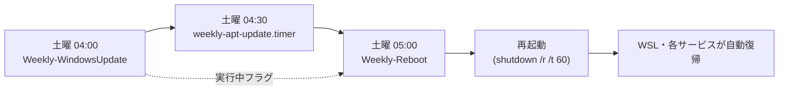

作成日: 2026-10-11 / STATUS: INFO / TOPIC: WINDOWS

# 毎週土曜の自動メンテナンス構築手順(Windows Update・再起動・apt)

- **記録日:** 2026-10-11
- **位置づけ:** Windows 11 Home 上で WSL(Windows Subsystem for Linux、Windows 内で Linux を動かす仕組み)を使うPCを、毎週土曜の早朝に「Windows Update → apt 更新 → 再起動」と自動で整える設定の構築手順書です。
- **対象読者:** 初心者(専門用語は初出時に意味を補足します)。
- **マスキング:** ホスト名・ユーザー名・ID等の固有情報は載せていません。機密情報(パスワード・トークン等)は一切含みません。

## 0. 結論

| 時刻(JST) | 実行する場所 | 内容 |
|---|---|---|
| 土曜 04:00 | Windows(タスクスケジューラー) | Windows Update の検索・ダウンロード・インストール |
| 土曜 04:30 | WSL(systemd タイマー) | `apt update -y` と `apt upgrade -y` |
| 土曜 05:00 | Windows(タスクスケジューラー) | 更新タスクの終了を待ち、60秒の猶予付きで再起動 |

- 追加ソフトのインストールは不要です(OS標準の機能のみ)。
- 再起動後は、WSL側のサービスも自動で復帰する構成を前提にしています(§7)。



## 1. 事前に確認した公式ドキュメント
- Windows Update Agent(WUA)API の使い方: https://learn.microsoft.com/ja-jp/windows/win32/wua_sdk/using-the-windows-update-agent-api
- IUpdateInstaller インターフェイス: https://learn.microsoft.com/en-us/windows/win32/api/wuapi/nn-wuapi-iupdateinstaller
- Register-ScheduledTask: https://learn.microsoft.com/ja-jp/powershell/module/scheduledtasks/register-scheduledtask
- shutdown コマンド: https://learn.microsoft.com/ja-jp/windows-server/administration/windows-commands/shutdown
- systemd.timer(Ubuntu マニュアル): https://manpages.ubuntu.com/manpages/noble/en/man5/systemd.timer.5.html

## 2. 方式の比較と選定理由
- **公式 WUA API(採用):** 追加導入が不要で公式です。
- **PSWindowsUpdate モジュール:** 手軽ですが第三者製です。導入するなら事前の信頼性確認が必要なため見送りました。
- **UsoClient:** 非公開のコマンドで挙動が不安定なため見送りました。
- **WSL内のcron ではなく systemd タイマー:** `apt` は管理者(root)権限が必要で、systemd のサービスなら root で実行できます。Windows が再起動で止まっていた場合の取りこぼしも `Persistent=true` で補えます。

## 3. 前提と注意
- タスクの登録・systemd ユニットの配置には**管理者権限**が必要です。Windows側は「管理者として実行」した PowerShell、WSL側は `sudo` で行います。
- タスクは SYSTEM アカウントで実行します。スクリプトを置くフォルダは、一般ユーザーが書き換えられない権限(読み取り・実行のみ)にします(§4.1)。
- 対象は通常のソフトウェア更新のみです。ドライバ更新と、ユーザー入力が必要な更新は対象外にしています。
- 強制終了(`/f`)は付けていません。保存していないアプリがあると再起動が止まる場合がありますが、データ消失を避ける方針です。

## 4. Windows 側の構築

### 4.1 フォルダと権限
`C:\ProgramData\WeeklyMaintenance\` を作り、ログ用の `logs` フォルダも作ります。管理者と SYSTEM にフルコントロール、一般ユーザーには読み取り・実行のみを与えます。

```powershell
$base = 'C:\ProgramData\WeeklyMaintenance'
New-Item -ItemType Directory -Force -Path $base, "$base\logs" | Out-Null
icacls $base /inheritance:r /grant:r 'Administrators:(OI)(CI)F' 'SYSTEM:(OI)(CI)F' 'Users:(OI)(CI)RX'
```

### 4.2 更新スクリプト `Invoke-WeeklyWindowsUpdate.ps1`
- 実行中は `update-running.flag` を作り、終了時に消します(再起動側が待つための目印)。
- `-SearchOnly` を付けると検索だけで終わります(試験用)。
- ログは直近20件を保持します。

```powershell
# Weekly Windows Update (Windows Update Agent API, no external modules)
# Usage: powershell -File Invoke-WeeklyWindowsUpdate.ps1 [-SearchOnly]
param([switch]$SearchOnly)
$ErrorActionPreference = 'Stop'
$base = 'C:\ProgramData\WeeklyMaintenance'
$logDir = Join-Path $base 'logs'
$flag = Join-Path $base 'update-running.flag'
New-Item -ItemType Directory -Force -Path $logDir | Out-Null
$log = Join-Path $logDir ('update_{0:yyyyMMdd}.log' -f (Get-Date))
function Log([string]$m) { ('{0:yyyy-MM-dd HH:mm:ss} {1}' -f (Get-Date), $m) | Out-File -FilePath $log -Append -Encoding utf8 }
# keep last 20 logs
Get-ChildItem $logDir -Filter *.log | Sort-Object LastWriteTime -Descending | Select-Object -Skip 20 | Remove-Item -Force -ErrorAction SilentlyContinue
try {
    Set-Content -Path $flag -Value (Get-Date).ToString('o')
    Log ('START SearchOnly=' + $SearchOnly)
    $session = New-Object -ComObject Microsoft.Update.Session
    $searcher = $session.CreateUpdateSearcher()
    # Type='Software' excludes drivers
    $result = $searcher.Search("IsInstalled=0 and IsHidden=0 and Type='Software'")
    Log ('Found updates: ' + $result.Updates.Count)
    $coll = New-Object -ComObject Microsoft.Update.UpdateColl
    foreach ($u in $result.Updates) {
        Log ('  - ' + $u.Title)
        if ($u.InstallationBehavior.CanRequestUserInput) { Log '    skipped (needs user input)'; continue }
        if (-not $u.EulaAccepted) { $u.AcceptEula() }
        [void]$coll.Add($u)
    }
    if ($SearchOnly -or $coll.Count -eq 0) {
        Log ('END (nothing installed). Candidates=' + $coll.Count)
        return
    }
    $dl = $session.CreateUpdateDownloader()
    $dl.Updates = $coll
    $dr = $dl.Download()
    Log ('Download ResultCode=' + $dr.ResultCode)
    $ins = $session.CreateUpdateInstaller()
    $ins.Updates = $coll
    $ir = $ins.Install()
    # ResultCode: 2=Succeeded 3=SucceededWithErrors 4=Failed 5=Aborted
    Log ('Install ResultCode=' + $ir.ResultCode + ' RebootRequired=' + $ir.RebootRequired)
    for ($i = 0; $i -lt $coll.Count; $i++) {
        Log ('  [' + $coll.Item($i).Title + '] result=' + $ir.GetUpdateResult($i).ResultCode)
    }
    Log 'END'
}
catch { Log ('ERROR: ' + $_.Exception.Message); exit 1 }
finally { Remove-Item $flag -Force -ErrorAction SilentlyContinue }
```

### 4.3 再起動スクリプト `Invoke-WeeklyReboot.ps1`
- 更新タスクの実行中フラグがある間、最大60分待ちます(3時間以上古いフラグは無視します)。
- `shutdown /r /t 60` で60秒前に通知します。**中止するには `shutdown /a`** を実行します。
- `-WhatIf` を付けると、実行せずログだけ残します(試験用)。

```powershell
# Weekly reboot. Waits for the update task to finish (max 60 min), then restarts with a 60 s notice.
# Cancel during the notice: shutdown /a
# Usage: powershell -File Invoke-WeeklyReboot.ps1 [-WhatIf]
param([switch]$WhatIf)
$base = 'C:\ProgramData\WeeklyMaintenance'
$logDir = Join-Path $base 'logs'
$flag = Join-Path $base 'update-running.flag'
New-Item -ItemType Directory -Force -Path $logDir | Out-Null
$log = Join-Path $logDir ('reboot_{0:yyyyMMdd}.log' -f (Get-Date))
function Log([string]$m) { ('{0:yyyy-MM-dd HH:mm:ss} {1}' -f (Get-Date), $m) | Out-File -FilePath $log -Append -Encoding utf8 }
Log ('START WhatIf=' + $WhatIf)
$deadline = (Get-Date).AddMinutes(60)
while ((Test-Path $flag) -and ((Get-Date) -lt $deadline)) {
    # ignore stale flag older than 3 hours
    if (((Get-Date) - (Get-Item $flag).LastWriteTime).TotalHours -gt 3) { Log 'stale flag ignored'; break }
    Log 'update task still running, waiting 30s'
    Start-Sleep -Seconds 30
}
if (Test-Path $flag) { Log 'WARN: update flag still present after wait; rebooting anyway' }
if ($WhatIf) { Log 'WhatIf: would run shutdown /r /t 60'; return }
Log 'Executing: shutdown /r /t 60'
& "$env:SystemRoot\System32\shutdown.exe" /r /t 60 /c 'Weekly maintenance restart. Cancel with: shutdown /a'
Log ('shutdown exit code=' + $LASTEXITCODE)
```

### 4.4 タスク登録スクリプト `Register-WeeklyMaintenanceTasks.ps1`
何度実行しても同じ結果になります(`-Force`)。**管理者の PowerShell** で実行します。

```powershell
# Registers the two weekly tasks (run in an elevated PowerShell). Re-runnable.
$base = 'C:\ProgramData\WeeklyMaintenance'
$ps = "$env:SystemRoot\System32\WindowsPowerShell\v1.0\powershell.exe"
$principal = New-ScheduledTaskPrincipal -UserId 'SYSTEM' -LogonType ServiceAccount -RunLevel Highest
function Reg($name, $script, $at, $limitHours, $desc) {
    $action = New-ScheduledTaskAction -Execute $ps -Argument ('-NoProfile -ExecutionPolicy Bypass -File "{0}\{1}"' -f $base, $script)
    $trigger = New-ScheduledTaskTrigger -Weekly -DaysOfWeek Saturday -At $at
    $settings = New-ScheduledTaskSettingsSet -WakeToRun -AllowStartIfOnBatteries -DontStopIfGoingOnBatteries `
        -ExecutionTimeLimit (New-TimeSpan -Hours $limitHours) -MultipleInstances IgnoreNew
    Register-ScheduledTask -TaskName $name -Action $action -Trigger $trigger -Settings $settings `
        -Principal $principal -Description $desc -Force | Out-Null
    Write-Host "registered: $name"
}
Reg 'Weekly-WindowsUpdate' 'Invoke-WeeklyWindowsUpdate.ps1' '04:00' 3 'Weekly Windows Update (Sat 04:00 JST)'
Reg 'Weekly-Reboot'        'Invoke-WeeklyReboot.ps1'        '05:00' 2 'Weekly restart (Sat 05:00 JST)'
```

- 共通設定: スリープ中なら起こす(`-WakeToRun`)、バッテリー駆動でも実行、多重起動しない、更新タスクは最大3時間・再起動タスクは最大2時間で打ち切り。
- 時刻にPCが停止していた場合に後から実行する設定(`StartWhenAvailable`)は付けていません。昼間に突然更新や再起動が走るのを避けるためです。

## 5. WSL 側の構築(apt の週次実行)

### 5.1 ユニットファイル
`weekly-apt-update.service`:

```ini
[Unit]
Description=Weekly apt update + upgrade (Sat 04:30 JST)
After=network-online.target
Wants=network-online.target

[Service]
Type=oneshot
# non-interactive: no prompts; keep existing config files; do not auto-restart services (PC reboots at 05:00)
Environment=DEBIAN_FRONTEND=noninteractive
Environment=NEEDRESTART_MODE=l
ExecStart=/usr/bin/apt update -y
ExecStart=/usr/bin/apt upgrade -y -o Dpkg::Options::=--force-confdef -o Dpkg::Options::=--force-confold
TimeoutStartSec=30min
```

`weekly-apt-update.timer`:

```ini
[Unit]
Description=Run apt update every Saturday 04:30 (after the Windows Update task at 04:00)

[Timer]
OnCalendar=Sat *-*-* 04:30:00
Persistent=true
Unit=weekly-apt-update.service

[Install]
WantedBy=timers.target
```

- 無人実行のための設定: 質問を出さない(`DEBIAN_FRONTEND=noninteractive`)、既存の設定ファイルを残す(`--force-confold`)、サービスの自動再起動をしない(`NEEDRESTART_MODE=l`)。
- `Persistent=true`: 04:30にWSLが止まっていた場合、次の起動時に1回だけ実行します。

### 5.2 導入スクリプト `install.sh`
```bash
#!/bin/bash
# Run with: sudo bash install.sh
set -euo pipefail
D="$(cd "$(dirname "$0")" && pwd)"
install -m 644 "$D/weekly-apt-update.service" /etc/systemd/system/weekly-apt-update.service
install -m 644 "$D/weekly-apt-update.timer"   /etc/systemd/system/weekly-apt-update.timer
systemd-analyze verify /etc/systemd/system/weekly-apt-update.service /etc/systemd/system/weekly-apt-update.timer
systemctl daemon-reload
systemctl enable --now weekly-apt-update.timer
systemctl list-timers weekly-apt-update.timer --no-pager
```

実行: `sudo bash install.sh`(`<配置したパス>/install.sh`)。最後に次回実行が土曜 04:30 と表示されれば成功です。

## 6. 検証手順と結果(2026-10-11 実施)

- **更新の検索のみ(SYSTEM権限の一時タスク):** 終了コード0、更新0件。一時タスクは削除済み。
- **更新スクリプトの本番モード単体実行:** 約8秒でエラーなく終了、更新0件。※ インストール処理は一度も通っていません(下記「未検証」参照)。
- **再起動スクリプトの `-WhatIf`:** 正常。
- **再起動スクリプトの本番実行:** `shutdown /r /t 60` が受理され(終了コード0)、約60秒後に再起動、約1分半で起動。イベントログにも記録を確認。
- **apt の手動実行:** `systemctl start weekly-apt-update.service` で約1分45秒、`Result=success`、6件(Docker関連・Chrome)が適用され、更新可能0件、`dpkg --audit` は空、コンテナ3つは自動復帰。

### 未検証の点
- タスクスケジューラー経由の**定時実行**(次回: 直近の土曜)。
- Windows Update の**インストール経路**(更新が0件だったため未通過)。
- 確認用に、実行後(土曜06:00)にログを読み取るだけの1回限りの確認ジョブを別途登録しています。

## 7. 運用上の注意とリスク
- **再起動との衝突:** `apt upgrade` の途中で再起動が走ると、パッケージが中途半端な状態で止まる可能性があります。04:30開始で通常は数分で終わるため30分の余裕を見ています。万一のときは `sudo dpkg --configure -a` で復旧します。
- **Dockerの更新:** 更新時にコンテナが数十秒止まります。`restart: unless-stopped` を付けたコンテナは自動復帰します。
- **WSL・常駐サービスの自動復帰:** Windows起動時にWSLを起こすタスク(別途用意)と、systemd の `enable` 済みサービスが前提です。
- 更新が長引いて再起動が遅れる場合は、フラグを最大60分待ちます。

## 8. 確認コマンド
```powershell
Get-ScheduledTask Weekly-* | Get-ScheduledTaskInfo
Get-Content (Get-ChildItem C:\ProgramData\WeeklyMaintenance\logs\*.log | Sort LastWriteTime | Select -Last 1).FullName
```
```bash
systemctl list-timers weekly-apt-update.timer
journalctl -u weekly-apt-update.service -n 30 --no-pager
```
- タスクの結果コード `267011` は「まだ一度も実行されていない」を意味する正常な値です。

## 9. 切り戻し
```powershell
Unregister-ScheduledTask Weekly-WindowsUpdate, Weekly-Reboot -Confirm:$false
Remove-Item C:\ProgramData\WeeklyMaintenance -Recurse -Force
```
```bash
sudo systemctl disable --now weekly-apt-update.timer
sudo rm /etc/systemd/system/weekly-apt-update.service /etc/systemd/system/weekly-apt-update.timer
sudo systemctl daemon-reload
```

## 10. 失敗・保留にした点
- 当初案の PSWindowsUpdate / UsoClient は §2 の理由で不採用。
- `StartWhenAvailable`(取りこぼし後の実行)は昼間の突発実行を避けるため不採用。Windows側の再起動がWSL内のaptの完了を待つ仕組みは、実装が複雑になるため見送り(現状は時間の余裕で対処)。

## Author and Ownership / 著作権と所属について

This project was created as a personal initiative and is not connected to any organization or group.
It is published as an individual creative work.

本プロジェクトは個人の活動として作成したものであり、特定の組織や団体の業務とは関係ありません。
個人の創作物として公開しています。
