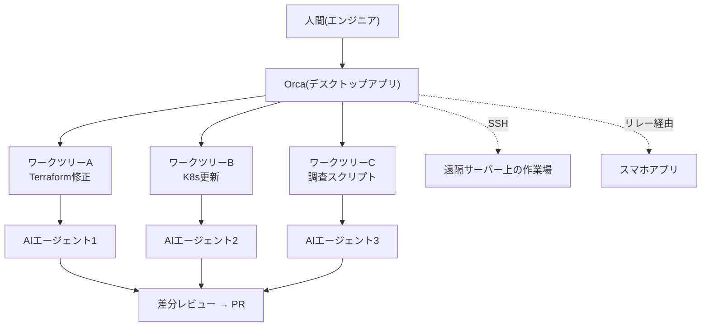
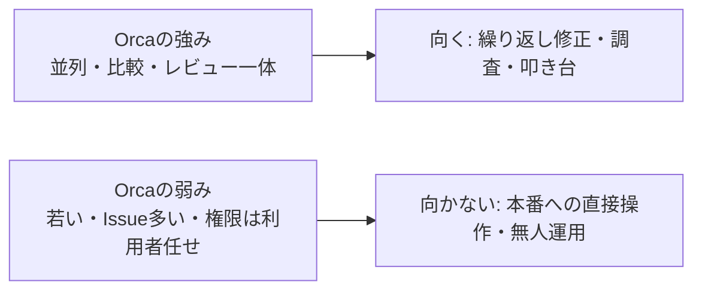

作成日: 2026-10-28 / STATUS: INFO / TOPIC: AIAGENT

# Orca(stablyai/orca)調査: 複数のAIコーディングエージェントを束ねる作業場と、自社IT企業・インフラ/クラウド業務への導入検討

- **記録日:** 2026-10-28
- **位置づけ:** GitHubで急上昇中のOSS「Orca」を調べ、自社のIT部門(特にインフラ・クラウドエンジニア)で使う場合の用途、具体例、メリット・デメリット、導入リスクを整理した調査メモです。
- **対象読者:** 初心者を含む方(専門用語は初出時に意味を補足します)。
- **根拠の区別:**
  - 【実測】GitHub API・公式ドキュメント(2026-10-28取得)で確認した事実
  - 【見立て】筆者(AI)の評価・設計案(未検証。実際に動かして試したものではありません)
- **マスキング:** 個人・機密情報は含みません。例中のリソース名・アカウントIDはすべて架空です。

## 0. 結論

**一言でいうと、Orcaは「複数のAIコーディングエージェントを、安全に並べて動かし、結果を見比べるための作業場(デスクトップアプリ)」です。**

- **向いている場面【見立て】:** 同じ種類の作業を、複数のリポジトリや環境に配る場面(Terraformの一斉修正、K8sのマニフェスト更新、調査スクリプトの量産、障害対応のレビュー)です。
- **導入判断【見立て】:** 「社内全体への一斉導入」はまだ早く、**小さなPoC(試験導入)から始める**のが妥当です。理由は次のとおりです。
  1. 公開から約7か月と若く、ほぼ毎日リリースされます(変化が速い)。
  2. 未解決のIssueが約7,900件あります。セキュリティ関連の未解決課題(スマホ連携の認証強化など)も複数あります。
  3. 本番環境に触るインフラ業務では、AIの暴走・誤操作の影響が大きくなります。
- **安全に使う鍵:** 本番の認証情報を渡さない、`plan`(計画の確認)までに限定する、人間が差分を必ずレビューする、の3点です。

## 1. Orcaとは(やさしい解説)

### 1.1 何をするソフトか
- **AIコーディングエージェント**とは、ターミナル(黒い画面)上で、コードを読み書きして作業を進めるAI(例: Claude Code、Codex)のことです。
- Orcaは、それらを**複数同時に**動かし、1つの画面で管理するアプリです。公式の説明は「AI Orchestrator(AIを取りまとめる司令塔)」です。
- 1人の人間が、何体ものAIに別々の仕事を任せ、進み具合を見て、結果を比べる使い方を想定しています。

### 1.2 核になる仕組み: git worktree
- **git worktree(ワークツリー)**とは、1つのリポジトリから、別々のフォルダとブランチを同時に作るGitの標準機能です。
- Orcaは、タスクごとに専用のワークツリーを作り、AIをその中で動かします。**AI同士が互いのファイルを壊さない**のが利点です。
- 公式の例: 1つの指示を5体のAIに配り、結果を比べて、一番良いものを採用する。

### 1.3 主な機能(公式ドキュメントより【実測】)
- **並列ワークツリー:** タスクごとに隔離された作業場を作る。
- **ターミナル分割:** 複数のAIの画面を並べる。
- **SSHワークツリー:** 遠隔のサーバー上でAIを動かし、画面は手元で見る。
- **GitHub / Linear連携:** PRやIssueをアプリ内で見て、そこから作業を始める。
- **AI差分への注釈:** AIが書いた差分の行にコメントを付け、AIに返して直させる。
- **Orca CLI:** `orca` コマンドで、ワークツリー作成や端末操作を**スクリプトやAIから**呼べる。
- **オーケストレーション:** タスクの依存関係(DAG)、担当割り当て、完了報告、判断待ち(承認ゲート)を管理する層。
- **利用量の追跡:** Claude Codeなどの使用量や制限までの残りを表示する。
- **モバイル連携:** スマホから進捗を見たり、追加の指示を送ったりする。
- **Computer Use:** AIにデスクトップアプリの操作をさせる機能。
- **対応エージェント:** Claude Code、Codex、Cursor、Copilot、OpenCode、**Hermes Agent**など30種超と、「ターミナルで動くCLIなら何でも」。

### 1.4 構成のイメージ



## 2. 信頼性チェック(外部ツール導入前の確認)

| 項目 | 結果【実測】 | 評価【見立て】 |
|---|---|---|
| Star数 | 108,180(依頼時は102,484で、数日で増加中) | 注目度は極めて高い |
| Fork数 | 6,839 | 利用・改造も多い |
| ライセンス | MIT | 商用利用しやすい |
| 公開時期 | 2026-03-17作成(約7か月) | 若い。実績は短い |
| 最終push | 2026-10-28(当日) | 活発。ほぼ毎日リリース(v1.4.242) |
| アーカイブ | いいえ | 放置ではない |
| 運営 | 企業「Stably」(2023年設立のGitHub組織、公開リポ24、フォロワー642) | 実在の企業。個人の使い捨てではない |
| 主要コミッター | 上位は5人前後が数千コミット | 少人数の高速開発 |
| 未解決Issue | 約7,937件 | 非常に多い。対応が追いつかない可能性 |
| セキュリティ窓口 | `SECURITY.md` なし、公開のセキュリティ勧告は0件 | 脆弱性の報告・公開の運用が見えない |
| テレメトリ(利用状況の送信) | 既定で匿名の利用統計をPostHog(米国)へ送信。環境変数で無効化できる | 企業利用では無効化を前提に |
| Windows署名 | SignPathによるコード署名 | 配布物の改ざん対策はある |

- **Star数の急伸には注意【見立て】:** 7か月で10万超は異例です。話題性や宣伝の影響もあり得るため、**Star数だけで品質を判断しない**ほうが安全です。
- **コードの目視監査:** 今回は実施していません(難読化や不審な通信の有無は未確認)。導入するなら、社内のセキュリティ担当による確認を勧めます。

## 3. 自社IT企業での使い方【見立て】

### 3.1 位置づけ
- **開発者の手元(ローカル)で使う道具**として導入するのが基本です。サーバー常駐のシステムではなく、各エンジニアのPCで動く**デスクトップアプリ**です(リポジトリの構成より、Electron製とみられます)。
- AIが使うモデルは、**各自が契約しているサブスクリプションやAPIキー**です(「自分の契約で動かす」が公式の説明)。Orca自体に料金はかかりません。

### 3.2 インフラ・クラウドエンジニア向けの具体例

> 注意: 以下は筆者の設計案です。`orca` コマンドの書式は公式ドキュメントにあるものを基にしていますが、実際に動かして検証してはいません。架空のリソース名を使っています。

#### 例1: Terraformの一斉バージョンアップ(新規構築・保守)
- **場面:** 10個のモジュールで、AWSプロバイダのバージョンを上げ、非推奨の書き方を直す。
- **進め方:**
  1. モジュールごとにワークツリーを作る。
  2. 各AIに「`terraform init` と `terraform validate` と `terraform plan` まで実行し、非推奨の警告を直し、差分を要約して」と指示する。
  3. 人間が各差分を見て、問題のあるものだけ手で直す。
- **コマンド例:**
```bash
# ワークツリーを作成(公式ドキュメントの書式)
orca worktree create --repo id:<repoId> --name upgrade-aws-provider-vpc --json
# AIの端末に作業を送る
orca terminal send --text "terraformのawsプロバイダを最新に上げ、validateとplanまで実施して差分を要約して" --enter --json
```
- **ガードレール:** 認証は**読み取り専用のロール**にする。`apply` はAIにさせない。

#### 例2: Kubernetesの廃止API対応(保守)
- **場面:** クラスターのバージョンアップ前に、廃止予定のAPI(古いマニフェストの書き方)を洗い出して直す。
- **進め方:** 複数のリポジトリ(アプリごと)に1体ずつAIを割り当て、ワークツリーでHelmチャートやYAMLを修正。`kubeconform` などの検証ツールで確認し、PRを作る。
- **効果【見立て】:** 同じ修正を何十回も手でやる退屈な作業を、並列で任せられる。

#### 例3: クラウドの棚卸しスクリプトの量産(調査)
- **場面:** 未使用のEBSボリューム、公開状態のS3バケット、期限切れ間近の証明書を一覧にする調査。
- **進め方:** 1つの依頼を、**3体のAI(別のモデル)に同時に配る**。出てきたスクリプトを比べ、一番読みやすく安全なものを採用する。
- **ガードレール:** スクリプトは**参照系のAPIのみ**で書かせ、実行前に人間が読む。

#### 例4: CI失敗の原因調査と修正PR(保守)
- **場面:** 夜間のCIが落ちた。ログから原因を調べ、修正のPRを作る。
- **進め方:** 失敗したPR番号から、ワークツリーを作る(`orca worktree create ... --pr 123`)。AIに原因調査と修正案を出させ、差分に注釈を付けて直させ、レビューしてマージ。

#### 例5: 障害対応の調査補助(遠隔サーバー・読み取りのみ)
- **場面:** 踏み台サーバー上のログを解析し、原因の仮説を出す。
- **進め方:** SSHワークツリーで、踏み台上のAIにログの要約を任せる。
- **ガードレール(重要):** 本番サーバーに**書き込み権限のある鍵**を渡さない。調査専用のアカウントを作り、操作ログを残す。**初回接続時にホスト鍵を自動で受け入れる既定がある**ため、`StrictHostKeyChecking yes` を使い、事前に鍵を登録する。

#### 例6: 手順書(ランブック)と構成図の整備(保守)
- **場面:** 属人化した運用手順を文章にする。
- **進め方:** Terraformコードやスクリプトを読ませ、手順書の草案を作らせる。人間が事実を確認して仕上げる。

#### 例7: 新規構築の叩き台づくり
- **場面:** 新サービス用のVPC、ECS(コンテナ実行基盤)、IAMロールの設計・コード化。
- **進め方:** 要件を渡し、**2〜3案を別のワークツリーで作らせて比較**する。採用案を人間が仕上げる。
- **注意:** セキュリティグループやIAMの権限は、AIが広すぎる権限を書きがちです。**最小権限になっているか**を必ず人間が確認する。

### 3.3 チームでの運用案
- **役割分担:** AIは「叩き台」と「退屈な繰り返し」を担当し、人間は「設計判断」と「最終承認」を担当する。
- **ルール化:** 以下を社内ルールにするとよい。
  1. 本番の認証情報をAIの環境に置かない(読み取り専用または開発環境のみ)。
  2. `apply` / `delete` / `destroy` などの破壊的な操作はAIに実行させない。
  3. AIの成果物は、必ず差分レビューを経てからマージする。
  4. 使ったAIとモデルを、PRの説明に書く。
  5. テレメトリは無効化する(環境変数 `ORCA_TELEMETRY_DISABLED=1`)。
  6. 信頼できないリポジトリは開かない(後述の`orca.yaml`フックの注意)。

## 4. メリット【見立て+実測】

1. **並列化で待ち時間を減らせる:** 複数のタスクを同時に進められる。
2. **安全に隔離される:** ワークツリーごとに作業場が分かれ、AI同士が衝突しにくい。
3. **比較による品質向上:** 同じ依頼を複数のAIに配り、良い案を選べる。
4. **エージェントを選ばない:** Claude Code、Codex、Hermes Agentなど、特定の製品に縛られない。
5. **レビューが一画面で完結:** 差分表示、注釈、コミット、PR作成まで、アプリ内で行える。
6. **MITライセンスで無料:** 商用利用でき、ソースが公開されている。
7. **自動化しやすい:** CLIとスキル(AIへの手順書)で、AI自身がOrcaを操作できる。
8. **遠隔でも使える:** SSHで、強力なマシン上の作業を手元から扱える。
9. **スマホで進捗確認:** 長い作業の完了通知を受けられる。

## 5. デメリット【見立て+実測】

1. **若く、変化が速い:** ほぼ毎日リリースされ、仕様が変わりやすい。業務の標準にするには追従コストがかかる。
2. **未解決Issueが多い:** 約7,900件。バグの修正を待たされる可能性がある。
3. **セキュリティ運用が見えにくい:** `SECURITY.md` がなく、公式の勧告も出ていない。
4. **AIの暴走を防ぐ仕組みは、本体の責任ではない:** 権限の絞り込みは、利用者側の運用に依存する。
5. **人間の確認が追いつかない恐れ:** 並列で大量の差分が出ると、レビューが追いつかず、見落としが増える。
6. **料金が見えにくくなる:** 複数のAIを同時に動かすと、APIの従量課金や、サブスクの利用上限を一気に消費する。
7. **学習コスト:** worktree、オーケストレーション、CLIなどの概念を覚える必要がある。
8. **デスクトップアプリ:** 全員のPCに入れて、更新を管理する手間がある(サーバー集中管理の仕組みではない)。
9. **環境差:** WindowsやLinuxではmacOSより情報が少なく、起動時の固まり等の報告もIssueに見られる(例: セキュリティ製品との相性問題)。

## 6. 導入リスクと対策

| # | リスク | 内容 | 影響 | 対策 |
|---|---|---|---|---|
| 1 | AIの誤操作・暴走 | AIが破壊的コマンドを実行する | 大 | 本番権限を渡さない。`apply`/`destroy`禁止。読み取り専用ロール |
| 2 | 認証情報の漏えい | AIの端末や履歴にキーが残る | 大 | 環境変数に本番キーを置かない。短期トークン。シークレットは別管理 |
| 3 | リポジトリ内の仕掛け | `orca.yaml` のフック(作業場の作成時に走るコマンド)や、悪意あるファイルが実行される | 中〜大 | 信頼できるリポジトリだけ開く。過去に「実行前の同意」を求めるIssueが出され、クローズ済み(対応状況は要確認) |
| 4 | スマホ連携の認証の弱さ | 公開Issueに、ペアリングで相手の身元を示さない、トークンが端末の識別子を兼ねる、等の指摘(2026-08時点で未解決) | 中 | 企業利用ではモバイル連携を無効にする。使うなら理解のうえで限定 |
| 5 | 外部リレーの経由 | スマホ連携は、開発元が運用するリレーを経由する(公式の`cloud/`の説明) | 中 | 機密案件では使わない。通信の暗号化の範囲は、今回確認できていない |
| 6 | テレメトリ | 既定で匿名の利用統計を米国のPostHogへ送る(内容は含まないと公式が説明) | 小〜中 | `ORCA_TELEMETRY_DISABLED=1` と設定画面で無効化。ファイアウォールで遮断 |
| 7 | SSH接続の初回ホスト鍵 | 既定は初回接続時に鍵を受け入れて記憶する | 中 | `StrictHostKeyChecking yes`、事前登録、踏み台の限定 |
| 8 | サプライチェーン | 毎日更新される配布物を取り込む | 中 | バージョンを固定。配布元と署名を確認。社内承認後に更新 |
| 9 | 利用規約・契約 | 複数アカウントの切り替え機能がある。各AI提供元の規約で、共有やアカウント切り替えが許されるか | 中 | 各社の規約と社内契約を確認してから使う |
| 10 | コスト急増 | 並列実行で従量課金が膨らむ | 中 | 月額の上限設定。同時実行数の制限。利用量の監視 |
| 11 | 品質・見落とし | 大量のAI差分で、レビューが形骸化 | 中 | 小さい単位で配る。必須レビュー。CIの自動検査を強化 |
| 12 | ツールの突然の変更 | 仕様変更、方針転換、開発の停止 | 中 | 代替手段(素のgit worktree+CLI)に戻れる運用にしておく |
| 13 | 個人情報・機密の入力 | プロンプトに機密が混ざり、AI提供元へ送られる | 大 | 機密区分のルール。送ってよい情報の基準を明文化 |

## 7. 導入の進め方(提案)

1. **フェーズ0 事前確認(1週間):** セキュリティ担当が、規約、テレメトリ、ライセンス、通信先を確認する。
2. **フェーズ1 PoC(2〜4週間):** 2〜3人の志願者が、**開発環境のみ**で試す。読み取り専用の認証で、例1〜3から始める。
3. **フェーズ2 評価:** 時間削減、品質、事故・ヒヤリハット、コストを記録して判断する。
4. **フェーズ3 限定展開:** ルールとチェックリストを整備して、対象チームを広げる。本番に近い作業は、承認フローを必須にする。
5. **見直し:** 四半期ごとに、継続・縮小・撤退を判断する。

## 8. 星取表(筆者の見立て)

◎=優れる / ○=良い / △=注意 / ×=弱い

| 観点 | 評価 | 理由 |
|---|---|---|
| 機能の豊富さ | ◎ | 並列、SSH、レビュー、CLI、モバイルまで揃う |
| 対応エージェントの幅 | ◎ | 30種超とCLIなら何でも |
| 導入の手軽さ | ○ | アプリを入れるだけ。ただし運用ルールは別途必要 |
| 安全性(設計) | △ | 隔離は良いが、権限制御は利用者任せ |
| セキュリティ運用の成熟 | △ | 勧告・窓口が見えず、関連Issueが未解決 |
| 安定性・成熟度 | △ | 7か月で毎日更新、Issueが多い |
| コスト | ○ | 本体は無料。ただしAI利用料が増える |
| 企業統制(管理・監査) | △ | 個人PCのアプリ。集中管理や監査ログは確認できていない |
| 継続性(開発の勢い) | ○ | 企業が運営し活発。ただし長期は未知 |
| インフラ業務との相性 | ○ | 同種の修正の並列処理に向く。本番操作には要注意 |



## 9. 他の選択肢との比較【見立て】

| 選択肢 | 特徴 | Orcaとの違い |
|---|---|---|
| Claude Code単体+手動のworktree | 最小構成。依存が少ない | 管理画面が無く、並列の把握が手作業 |
| tmuxなどで自作 | 自由度が高く、依存ゼロにできる | 作り込みと保守が必要 |
| IDE内蔵のエージェント(Cursor等) | 編集体験が滑らか | 複数エージェントの並列管理は設計の主眼ではない |
| クラウド型のエージェント | 集中管理しやすい | コードを外部に預ける前提の製品が多い |
| Hermes Agent等の常駐型 | 自動化・通知・スケジュールに強い | Orcaは「人が横で見る作業場」、Hermesは「裏で動く秘書」。**併用も可能**(OrcaはHermes Agentを対応エージェントとして挙げている) |

## 10. 限界と注意

- **未検証:** 筆者は実際にOrcaを動かしていません。使い方の例は、公式ドキュメントと一般的な運用知識からの設計案です。
- **コード監査なし:** ソースコードの目視監査(不審な通信、難読化など)は未実施です。
- **変化が速い:** 数日で内容が変わり得ます。導入時点の最新版と公式ドキュメントを再確認してください。
- **モバイル連携の暗号化など:** 通信内容の保護範囲は、今回確認できていません。
- **規約の確認:** AI提供元ごとの利用規約への適合は、法務・調達の確認が必要です。

## 11. 出典

- リポジトリ: https://github.com/stablyai/orca (README、LICENSE、Releases、Issues)
- 公式サイト・ドキュメント: https://onorca.dev / https://www.onorca.dev/docs/
  - Privacy & Telemetry: https://www.onorca.dev/docs/telemetry
  - SSH worktrees: https://www.onorca.dev/docs/ssh
  - Orca CLI overview: https://www.onorca.dev/docs/cli/overview
  - Orchestration: https://www.onorca.dev/docs/cli/orchestration
  - Worktrees: https://www.onorca.dev/docs/model/worktrees
  - Usage & rate-limit tracking: https://www.onorca.dev/docs/agents/usage-tracking
- 関連Issue: stablyai/orca #17400(モバイルペアリングの身元)、#17398、#17395、#1137(`orca.yaml`フックの同意)
- リレーの説明: リポジトリ内 `cloud/README.md`
- Git公式: git worktree https://git-scm.com/docs/git-worktree
