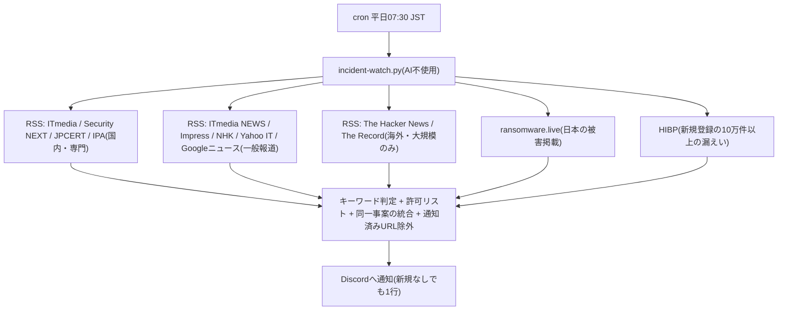

作成日: 2026-11-18 / STATUS: INFO / TOPIC: SECURITY

# インシデントウォッチ(平日朝の情報漏えい・不正アクセス監視)構築手順

- **記録日:** 2026-11-06(2026-11-18 改訂: 一般報道の追加と事案統合)
- **種別:** SETUP(構築手順)
- **関連:** 脆弱性ウォッチ(`048_INFO_SETUP_weekday-cve-watch.md`)の「事件版」

## 1. 目的
情報漏えい・不正アクセス・ランサムウェア・サイバー攻撃の最新報道を、**国内を優先**して毎朝1回Discordに通知する。AI不使用・無料・追加導入なし(Python標準ライブラリのみ)。

## 2. 全体像


## 3. 構成
| 項目 | 内容 |
|---|---|
| スクリプト | `~/.hermes/scripts/incident-watch.py` |
| cron | `weekday-incident-watch`(平日 07:30 JST、`no_agent`型) |
| 状態ファイル | `~/.hermes/state/incident-watch.json`(通知済みURL、30日で破棄) |
| 対象期間 | 直近72時間(月曜朝に金〜日の分を拾うため) |
| 時刻の理由 | 07:00のtaskboard-poller・毎時00分の監視を避け、深夜帯の週次ジョブとも重ならない |

## 4. 判定ルール
- **種別:** ランサム / 情報漏えい / 不正アクセス / サイバー攻撃 をキーワードで判定。
- **🔴=被害確認の報道**(漏えい・流出・ランサム等の語を含む)、**🟡=疑い・調査中の可能性**。
- **国内:** 全件対象。**海外:** 大規模(million、政府、病院、銀行等の語)のみ。それ以外は「その他」に件数のみ。
- **脆弱性のみの記事は除外**(脆弱性ウォッチの担当)。
- **並び順:** 国内 > 被害確認 > 件数の大きい順 > 新しい順。
- **ransomware.live:** 犯行グループの暴露サイトへの掲載は「主張」であり未確認のため、その旨を併記。

## 5. 通知の形式
```
🔴 [国内] ビックカメラG、メールアドレスなど約1490万件漏えいの可能性 …
　🏷 情報漏えい・不正アクセス ／ 約1,490万件｜11/04 ITmedia｜🔗 URL
```
新規なしの日は「✅ 新規なし」、情報源の多くが取得できない日は「⚠️ 判定できません」と明示。Discord上限のため1通は約1,990字以内(超過分は「ほかN件」)。

## 6. 試験結果(2026-11-06)
- 正常系: 実データで21件を判定(アソビュー1,582万件、ビックカメラ1,490万件等が上位)。
- 重複除外: 1回目に保存、2回目は「新規なし」を確認。
- 異常系: 通信不可を模擬し、「新規なしとは判定できません」と表示。
- 試験用状態ファイルは削除。本番の状態ファイルは未作成(初回は全件が新規として届く)。

## 7. 失敗した方法・直した点
- BleepingComputer・SecurityWeekは403で遮断され取得不可のため対象外。
- ransomware.liveは項目名が想定と違い(`post_title`/`group_name`)、被害者名が空になった → 修正。連続アクセスで429(制限)になるため、試験の連打は避ける。
- 初版は大規模案件が「省略」に回った → 2行カード化と規模順の並べ替えで解消。

## 8. 既知の制約
- キーワード判定のため、過検知・見落としがある(運用して調整する前提)。
- 英語記事は見出しが英語のまま(AI翻訳なし)。
- (改訂前の制約)同一事案が複数媒体に出ると重複していた → 第10章で統合に対応。
- 速報性は記事の公開待ち(半日〜1日の遅れ)。
- 初回(11/9月曜)は72時間分がまとめて届く。

## 9. 運用メモ
- テーマ指定なしで開始。運用しながら、キーワードや対象企業の追加で調整する。
- 試験: `INCWATCH_STATE=<別パス> python3 incident-watch.py --dry`(状態を更新しない)。
- 将来の拡張案: 新規がある日だけAIで日本語要約(トークン消費あり)。


## 10. 改訂 2026-11-18: 一般報道の追加(取りこぼし対策)

### 10.1 きっかけと原因
- ある証券会社の大規模漏えい(最大約1,125万口座、公式発表の翌朝)が、通知に出なかった。
- 実測すると、**専門4フィード(ITmediaセキュリティ欄・Security NEXT・JPCERT・IPA)にその記事が載っていなかった**。同じITmediaでも、記事は一般ニュース欄にあった。
- 判定の不具合ではなく、**「見る範囲(情報源)」の不足**が原因だった。

### 10.2 変更点(追加のみ・既存の専門4フィードは不変)
| 変更 | 内容 |
|---|---|
| 一般報道5件を追加 | ITmedia NEWS、Impress Watch、NHK社会、Yahoo!ニュースIT、Googleニュース(「不正アクセス OR 情報漏えい OR ランサムウェア」検索・直近2日) |
| 厳格判定 | 一般報道は**タイトルに強い語**(不正アクセス・漏えい・流出・ランサム等)が必須。解説記事(「とは」「仕組み」「対策まとめ」等)は除外 |
| 許可リスト | Googleニュース経由は`TRUSTED_GNEWS`(朝日・読売・NHK・日経など約30媒体)のみ採用。**媒体の追加は、この一覧に1語足すだけ** |
| 同一事案の統合 | 除外語(「不正アクセス」等の一般語)を除いた4文字連続が一致すれば同一事案とみなし、1件にまとめて「+ほかN媒体」と表示 |
| 統合の補正 | 末尾の「(媒体名)」「[地域]」を比較から除外し、統合時に他記事の件数を持ち込まない(別事案への誤統合対策) |
| 規模判定の拡張 | 「件」に加え「口座」「人分」「アカウント」も数える |
| 表示枠 | カード表示の上限を1,250→1,400字に拡大 |

### 10.3 試験結果
- 旧版(同条件): 国内の大型案件は0件(専門媒体の中小案件のみ)。
- 新版: 大型案件(約1,572万件・約1,829万件など)が上位に表示。重複を97件→24件に整理。
- 本番ジョブを手動で1回実行し、Discordへ到達することを確認(約15秒で完了、26件を通知)。この結果から、**別事案の誤統合**(脆弱性記事に他社の件数が混ざる)を発見し、上記の補正を追加して再試験した。
- 試験は`INCWATCH_STATE=<別パス> python3 incident-watch.py --dry`(状態を更新しない)で実施。その後、cronの本番ジョブを手動で1回実行し、Discord到達を確認(詳細は上記)。

### 10.4 失敗した方法・直した点
- 初版は一般報道を多数入れた結果、1回で約107件になり質も低下 → 許可リストと解説記事の除外で大幅削減。
- 事案統合の初版は、統合後の語も比較対象に含めたため、別事案まで連鎖的に合流 → 各事案の「代表記事」だけと比較する方式に修正。
- 次に、記事末尾の媒体名(例: 「(○○新聞オンライン)」)の一致で別事案が合流 → 末尾の括弧書きを除いて比較。
- ZDNet Japan・CNET JapanのRSSは取得できなかった(0件/404)ため対象外。

### 10.5 既知の弱点(追加分)
- 表記違い(例: カタカナ/ローマ字の社名)は、別事案として2件に分かれる。
- 一般報道由来の「脆弱性・稼働延期」のような、漏えいではない記事が混ざることがある。
- Googleニュースのリンクは中継URLで長い。
- 速報性は、各媒体の掲載待ち(数時間〜半日)に依存する。

### 10.6 切り戻し
- 改訂前のスクリプトを別途退避済み。戻す場合は退避ファイルを`~/.hermes/scripts/incident-watch.py`へコピーし直す(状態ファイルは互換のため変更不要)。

## 参考(公式・情報源)
- JPCERT/CC: https://www.jpcert.or.jp/
- IPA: https://www.ipa.go.jp/security/
- ransomware.live: https://www.ransomware.live/
- Have I Been Pwned: https://haveibeenpwned.com/

## Author and Ownership / 著作権と所属について

This project was created as a personal initiative and is not connected to any organization or group.
It is published as an individual creative work.

本プロジェクトは個人の活動として作成したものであり、特定の組織や団体の業務とは関係ありません。
個人の創作物として公開しています。
